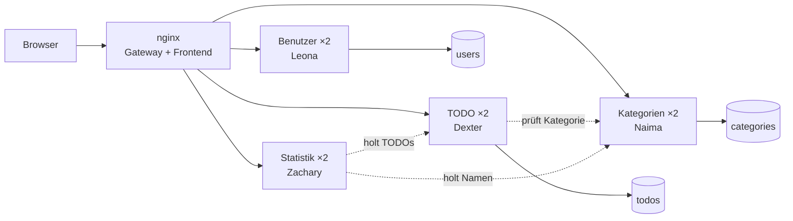

# Architektur auf einer Seite

> **TL;DR:** Der Browser spricht nur mit **nginx** (Port 8080). nginx verteilt jede Anfrage auf eine von **zwei Instanzen** des richtigen Services.
> Jeder Service hat **seine eigene Datenbank**. Wer etwas von einem anderen Service braucht, **fragt über HTTP** und gibt das **JWT** des Benutzers mit.
> Stürzt etwas ab, **startet Docker/Kubernetes es neu**. Fällt eine Instanz aus, **nimmt nginx die andere**.

## Das Bild

(Ohne Mermaid-Ansicht: `Browser → nginx → {Benutzer, TODO, Kategorien, Statistik} je 2×`; TODO → Kategorien; Statistik → TODO + Kategorien; drei Datenbanken in einem PostgreSQL.)

## Die 6 Ideen, die man erklären können muss

| # | Idee | Warum | Wo im Code |
|---|---|---|---|
| 1 | **Ein Einstiegspunkt** (Reverse Proxy) | Browser kennt nur eine Adresse, kein CORS, Services bleiben intern | `gateway/templates/default.conf.template` |
| 2 | **Database per Service** | Jeder Service besitzt seine Daten, niemand greift fremd in eine DB. Deshalb hat `todos.category_id` **keinen** Fremdschlüssel | `deploy/db/init.sh`, `services/*/src/server.js` |
| 3 | **JWT statt Sessions** | Jeder Service prüft das Token selbst (gemeinsames Secret). Die Instanzen merken sich nichts, deshalb ist egal, welche antwortet | `services/*/src/auth.js` |
| 4 | **userId nur aus dem Token** | Niemand kann sich als jemand anderes ausgeben. Fremde Daten → 404 | `WHERE id = $1 AND user_id = $2` in jedem Service |
| 5 | **Aufrufe mit Timeout + Fallback** | Ein langsamer/toter Service blockiert die anderen nicht (2 s, dann verständliche Meldung) | `services/*/src/client.js` |
| 6 | **2 Instanzen + Auto-Neustart** | die zwei HA-Massnahmen (N06) | `docker-compose.yml`, `deploy/k8s/*.yaml` |

## Eine Anfrage von A bis Z: «TODO als erledigt markieren»

1. Frontend: `PATCH /api/todos/<id>` mit `{"status":"done"}` und `Authorization: Bearer <JWT>`.
2. nginx: entfernt `/api`, wählt `todo-service-1` oder `-2`, setzt `X-Request-Id`.
3. todo-service: prüft das JWT → `userId`. Sucht das TODO **mit** `user_id`. `completedAtFor()` setzt `completedAt` = jetzt. Speichert.
4. Antwort `200` mit dem TODO. Jede Antwort enthält `X-Instance` und zeigt, welche Instanz geantwortet hat.
5. Später `GET /api/stats`: stats-service holt alle TODOs beim todo-service und rechnet die Ø-Dauer aus `completedAt − createdAt`.

## Was passiert, wenn …

| … das ausfällt | Folge für den Benutzer |
|---|---|
| eine Instanz eines Services | nichts, nginx nimmt die andere |
| beide Kategorien-Instanzen | TODOs gehen weiter, nur «Kategorie zuordnen» meldet einen Fehler. Statistik ohne Namen |
| beide TODO-Instanzen | TODO-Seite und Statistik melden nach ~2 s «nicht erreichbar» |
| ein Prozess stürzt ab | nach ~1–3 s automatisch neu gestartet |
| die Datenbank | kurze Störung, keine Daten weg (Volume). **Bekannter Single Point of Failure** |

## Betriebsarten

| Variante | Befehl | Adresse |
|---|---|---|
| alles auf einer VM | `docker compose up -d --build` | `:8080` |
| jeder Service auf eigener VM | `services/<x>/docker-compose.yml` + `gateway/docker-compose.yml` | `:8080` auf der Gateway-VM |
| Kubernetes (microk8s) | `./scripts/k8s-deploy.sh` | `:30080` |

**Termine:** Abgabe **26.10.2026** · Demo + Testing **02.11.2026**
