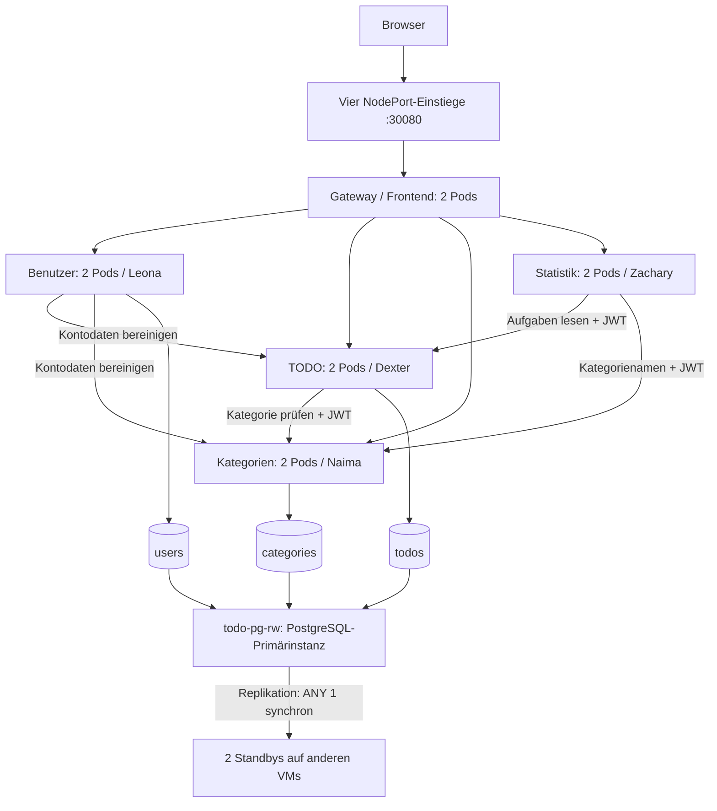

# Architektur des gemeinsamen Clusters

Stand: 26.10.2026. Aktive Betriebsart: MicroK8s v1.35.6, Namespace `todo-app`.

| Person | VM / Knoten | Einstieg |
|---|---|---|
| Naima | 10.4.31.11 / m321-11-ap23a | http://10.4.31.11:30080 |
| Dexter | 10.4.31.13 / m321-13-ap23a | http://10.4.31.13:30080 |
| Leona | 10.4.31.16 / m321-16-ap23a | http://10.4.31.16:30080 |
| Zachary | 10.4.31.17 / m321-17-ap23a | http://10.4.31.17:30080 |

Die Datenbanksymbole sind drei **logische Datenbanken** innerhalb desselben PostgreSQL-Clusters. Jede der drei PostgreSQL-Instanzen hält eine Kopie dieses Datenbankverbunds. Statistik hat keine eigene Datenbank.

## Wege einer Anfrage

Der Browser ruft `/api/...` über ein Gateway auf. nginx entfernt `/api` und verwendet Kubernetes-Service-Namen wie `category-service:3000`. Die Upstream-Einträge zeigen im Cluster auf diese stabilen Service-Adressen; Kubernetes verteilt auf bereite Pods. Die Zuständigkeit einer Person bindet ihren Service nicht an eine VM. Erforderliche Pod-Anti-Affinität verteilt zwei Replikate desselben Deployments auf verschiedene VMs.

Beim TODO-Anlegen prüft Dexter `GET /categories/{id}` mit dem Benutzer-JWT bei Naima: 200 erlaubt, 404 führt zu 422, nicht erreichbar führt zu 503. Bestehende unveränderte Kategoriezuordnungen werden nicht erneut geprüft. Zachary liest TODOs und `categories?includeDeleted=true` per API. Leona löscht bei Kontolöschung zuerst TODOs, dann Kategorien, zuletzt das Konto. Dieser Ablauf ist keine serviceübergreifende Transaktion.

## Datenhaltung

CloudNativePG 1.30.1 verwaltet PostgreSQL 17 mit drei Instanzen. Apps schreiben über `todo-pg-rw:5432`, mit separaten Rollen `user_svc`, `todo_svc`, `category_svc`. `ANY 1` und `dataDurability: required` verlangen für bestätigte Schreibvorgänge neben der Primärinstanz mindestens einen synchronen Standby.

Lokale PersistentVolumes: `/var/snap/microk8s/common/m321-postgres`, StorageClass `m321-local`, ReclaimPolicy `Retain`. Je Volume sind 2 Gi deklariert; das ist keine Dateisystem-Quota. Die belegten Datenkopien liegen im geprüften Stand auf .13, .16 und .11; .17 bietet ein Reserve-Volume. Ein lokales Volume wandert bei VM-Ausfall nicht mit. PostgreSQL schaltet auf eine andere vorhandene Kopie um. Replikation ersetzt kein Backup.

## Einstieg und Ausfallverhalten

Das Frontend kennt vier API-Einstiege über `frontend/runtime-config.js`, wählt anhand von Health-Prüfungen einen erreichbaren Einstieg und wiederholt Schreiboperationen bei unklarem Ergebnis nicht blind. CORS erlaubt die vier Team-Adressen. Eine bereits geladene Seite kann die API-Adresse wechseln. Beim ersten Öffnen oder Neuladen einer ausgefallenen VM-Adresse ist eine andere Adresse nötig; eine gemeinsame ausfallsichere URL fehlt.

| Störung | Verhalten / Nachweis |
|---|---|
| Ein App-Pod | Andere Replikate können weiterarbeiten; Kubernetes ersetzt den Pod. Laufende Anfragen können scheitern. |
| Eine VM | Nach Erkennung und ggf. DB-/Steuerungsebenen-Umschaltung wieder vollständige Abläufe; vier einzelne Netzisolationsversuche belegt. |
| Alle Kategorie-Pods | Neue Zuordnung scheitert; TODOs ohne neue Zuordnung bleiben möglich, Statistik kann ohne Namen antworten, sofern übrige Abhängigkeiten gesund sind. |
| Alle TODO-Pods | TODO-Funktionen und Statistik melden Fehler. |
| Mehrere VMs / Datenträgerverlust | Kein durchgeführter Nachweis für zuverlässigen Betrieb bzw. Wiederherstellung. |

Längste beobachtete Fehlerphase der VM-Tests: etwa 81 s. Zwei Replikate bedeuten keine Null-Unterbrechung. Details: [Tests](testprotokoll.md), [Betrieb](betrieb-cluster.md).
