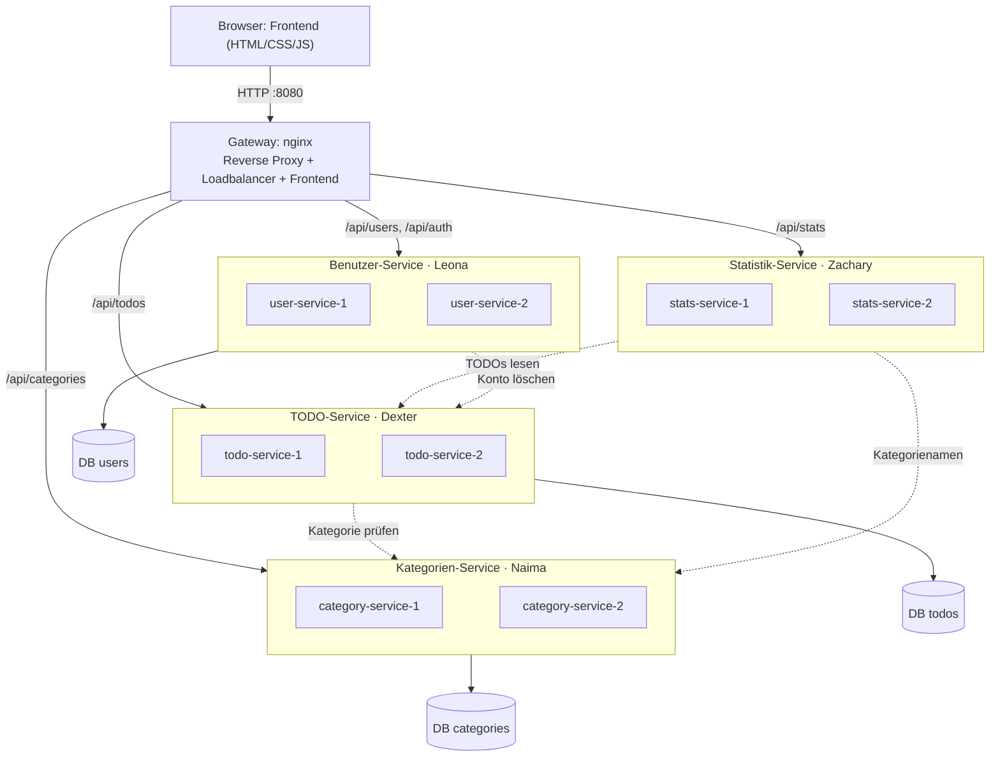
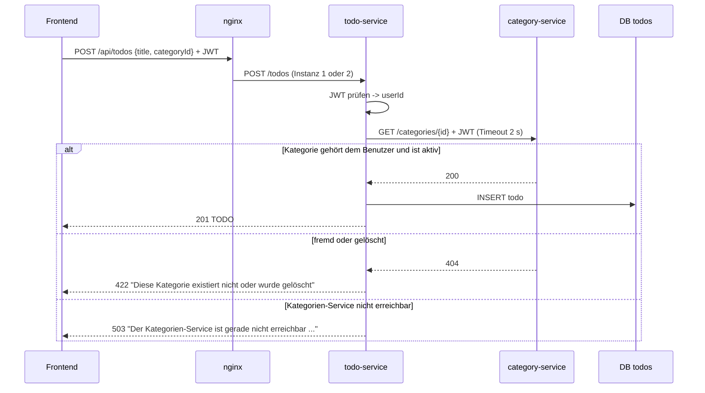
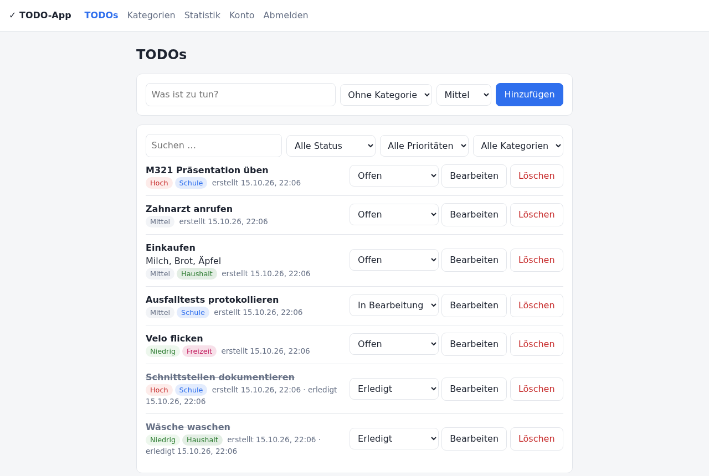
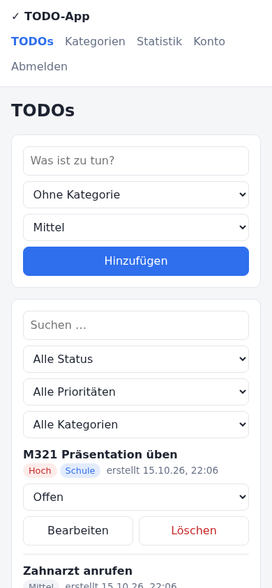
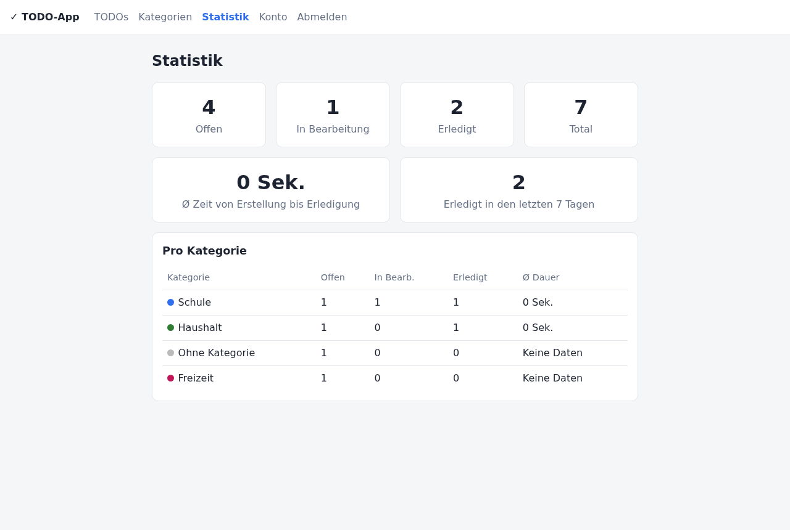
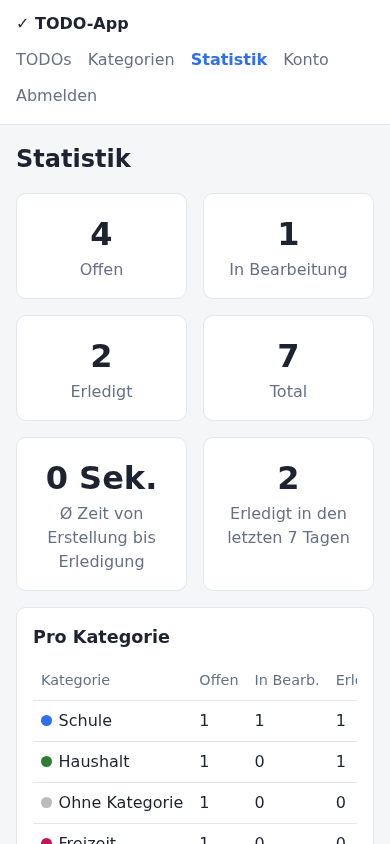
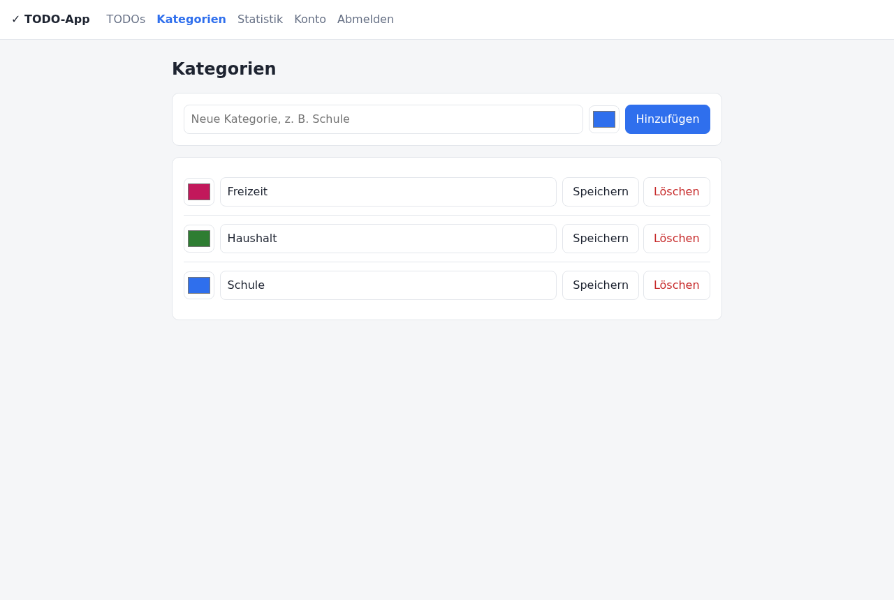
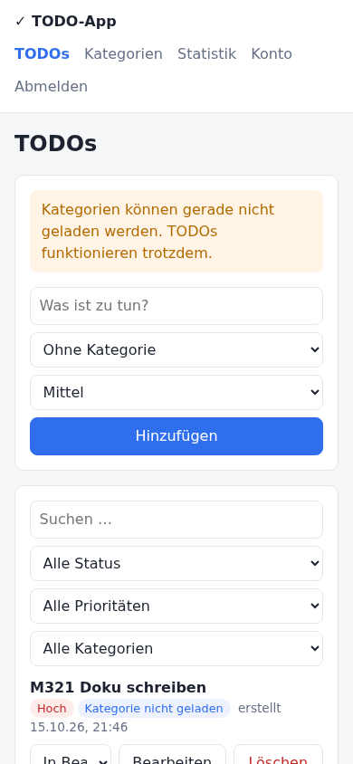

# Verteilte TODO-Applikation: Dokumentation LB2

| | |
|---|---|
| **Modul** | M321 Verteilte Systeme programmieren, TBZ, Klasse AP23a |
| **Gruppe** | Leona · Zachary · Naima · Dexter |
| **Repository** | https://github.com/dexter-zurbruegg/M321_LB2_Leona_Zachary_Naima_Dexter |
| **Branch mit dem finalen Stand** | `develop` |
| **Abgabe** | Projektarbeit 26.10.2026 · Testing und Demo 02.11.2026 |
| **Version** | 1.0 |

---

## Inhaltsverzeichnis

1. [Vorgehen (Projektplanung)](#1-vorgehen-projektplanung)
2. [Anforderungen und Features](#2-anforderungen-und-features)
3. [Verteiltes System im Überblick](#3-verteiltes-system-im-überblick)
4. [Systemkomponenten](#4-systemkomponenten)
   - 4.1 [Benutzer-Service (Leona)](#41-benutzer-service-leona)
   - 4.2 [TODO-Service (Dexter)](#42-todo-service-dexter)
   - 4.3 [Kategorien-Service (Naima)](#43-kategorien-service-naima)
   - 4.4 [Statistik-Service (Zachary)](#44-statistik-service-zachary)
   - 4.5 [Frontend (alle)](#45-frontend-alle)
   - 4.6 [Reverse Proxy / Loadbalancer (Dexter + Leona)](#46-reverse-proxy--loadbalancer-dexter--leona)
5. [Hochverfügbarkeit](#5-hochverfügbarkeit)
6. [Installation auf LernMAAS](#6-installation-auf-lernmaas)
7. [Tests (Übersicht)](#7-tests-übersicht)
8. [Fazit und Ausblick](#8-fazit-und-ausblick)
9. [Anhang](#9-anhang)

---

## 1. Vorgehen (Projektplanung)

Wir haben das Projekt nach dem Vorgehen aus dem Auftrag LB2 in sechs Phasen umgesetzt (Details in der [Planung](../planung_projektarbeit.md)):

| Phase | Ergebnis |
|---|---|
| 1. Planung und Schnittstellen | Anforderungen F01–F10 / N01–N08 priorisiert, Aufteilung in vier Services, Planung von der Lehrperson freigegeben. Danach API-Verträge in [schnittstellen.md](schnittstellen.md) festgelegt, **zuerst das JWT-Format**, weil alle anderen Services davon abhängen. |
| 2. Technisches Grundgerüst | Ordnerstruktur, ein Dockerfile pro Service, `/health`, eigene Datenbank pro Service, `docker compose` auf LernMAAS. HA-Konzept früh ausprobiert (zwei Instanzen hinter nginx). |
| 3. Pflichtfunktionen | Jede Person baut ihren Service und die passende Seite im Frontend, mit Tests. |
| 4. Integration | Reverse Proxy als einziger Einstieg, Service-Adressen per Umgebungsvariablen, ganzer Ablauf F09 getestet. |
| 5. HA und Ausfalltests | Zwei Instanzen pro Service + automatischer Neustart; Ausfalltests als Skript, Ergebnisse protokolliert. |
| 6. Abschluss | Fehler aus den Ausfalltests behoben (siehe 5.4), Dokumentation, Demo geprobt. |

**Zusammenarbeit mit Git:** Jede Person arbeitet auf ihrem Branch `Feature-<Name>`, gemerged wird nach `develop`.
`develop` enthält den finalen Stand, `main` bleibt für die Abgabe.
Schnittstellenänderungen werden vorher mit allen abgestimmt, die die Schnittstelle benutzen (Tabelle in [schnittstellen.md §1.4](schnittstellen.md#14-aufrufe-zwischen-services-timeouts-ausfälle)).

**Technologieentscheid:** Der Auftrag erlaubt pro Komponente eine eigene Technologie. Wir haben uns trotzdem für **einen** Stack entschieden (Node.js 22 + Express 5, PostgreSQL 17, nginx).
So kann jede Person den Code der anderen lesen und bei Problemen helfen. Weil die Schnittstellen sauber über HTTP/JSON laufen, könnte man jeden Service trotzdem in einer anderen Sprache neu schreiben.

## 2. Anforderungen und Features

Priorität: **Muss** = Mindestumfang (muss für die Abgabe funktionieren). **Kann** = Zusatzfeature, erst nach den Muss-Anforderungen.
Die Testfall-IDs verweisen auf das [Testprotokoll](testprotokoll.md).

### 2.1 Funktionale Anforderungen

| ID | Anforderung | Prio | Komponente | Status | Nachweis |
|---|---|---|---|---|---|
| F01 | Benutzer erstellen, bearbeiten, löschen | Muss | Benutzer | ✅ | TC-U01–U03, U07, U08, U10 |
| F02 | Anmelden und Abmelden | Muss | Benutzer | ✅ | TC-U04–U06, U09 |
| F03 | Eigene TODOs erstellen, anzeigen, bearbeiten, löschen | Muss | TODO | ✅ | TC-T01–T03 |
| F04 | Status offen / in Bearbeitung / erledigt | Muss | TODO | ✅ | TC-T04 |
| F05 | Eigene Kategorien erstellen, bearbeiten, löschen | Muss | Kategorien | ✅ | TC-K01–K05 |
| F06 | TODO einer Kategorie zuordnen (max. 1) | Muss | TODO + Kategorien | ✅ | TC-T05–T07 |
| F07 | Anzahl offener und erledigter TODOs | Muss | Statistik | ✅ | TC-S01, S02 |
| F08 | Ø Zeit Erstellung → Erledigung, «Keine Daten» bei 0 | Muss | Statistik | ✅ | TC-S01, S03, Unit-Tests |
| F09 | Eine Weboberfläche verbindet alle vier Services | Muss | Frontend | ✅ | TC-E01, Demo |
| F10 | Verständliche Fehler- und Ladezustände | Muss | alle | ✅ | TC-U03, HA-04, HA-05, Screenshots |
| Z1 | Filter nach Status und Kategorie | Kann | TODO | ✅ | TC-T08 |
| Z2 | Suche nach TODO-Titel | Kann | TODO | ✅ | TC-T08 |
| Z3 | Prioritäten niedrig / mittel / hoch | Kann | TODO | ✅ | TC-T01, T03, T08 |
| Z4 | Farbe pro Kategorie | Kann | Kategorien | ✅ | TC-K01, K02, K04 |
| Z5 | Statistik pro Kategorie, «erledigt in den letzten 7 Tagen» | Kann | Statistik | ✅ | TC-S04, Unit-Tests |

Bewusst **nicht** umgesetzt (wie in der Planung): E-Mail-Erinnerungen, Teamfreigaben, Echtzeit-Synchronisation, wiederkehrende Aufgaben.

### 2.2 Nicht-funktionale Anforderungen

| ID | Anforderung | Prio | Umsetzung | Nachweis |
|---|---|---|---|---|
| N01 | 4 Services getrennt startbar, APIs dokumentiert | Muss | eigene `docker-compose.yml` pro Service, [schnittstellen.md](schnittstellen.md) | Einzelstart getestet (Testprotokoll §4) |
| N02 | Nur eigene Daten (serverseitig) | Muss | `userId` nur aus dem geprüften JWT, jede SQL-Abfrage mit `user_id`, fremd = 404 | TC-T09, K06, S05 |
| N03 | Passwörter gehasht, keine Secrets im Repo | Muss | bcrypt (Kostenfaktor 10), `.env` in `.gitignore`, `init-env.sh` erzeugt Zufallswerte | TC-U01, Code-Review |
| N04 | Daten überleben Neustart | Muss | PostgreSQL mit Docker-Volume bzw. PersistentVolume | HA-06, K8S-03 |
| N05 | Läuft auf LernMAAS | Muss | Docker Compose oder microk8s auf der M321-VM | Kapitel 6 |
| N06 | 2 HA-Massnahmen + Ausfalltests | Muss | 2 Instanzen + Loadbalancer, automatischer Neustart | HA-01–06, K8S-01–03 |
| N07 | Desktop + Mobile | Muss | responsives CSS (ab 640 px gestapelt) | Screenshots Anhang |
| N08 | Doku für Installation, Konfiguration, APIs, Tests | Muss | README, schnittstellen.md, testprotokoll.md | – |

## 3. Verteiltes System im Überblick



Durchgezogene Pfeile: Anfragen über den Proxy bzw. Zugriff auf die eigene Datenbank. Gestrichelt: Aufrufe zwischen Services über deren API (immer mit dem JWT des Benutzers).
Die drei Datenbanken liegen in **einer** PostgreSQL-Instanz, jede mit eigenem DB-Benutzer. Beim Konto löschen ruft der Benutzer-Service auch den Kategorien-Service auf.

**So hängt alles zusammen:**

- Der **Browser** spricht nur mit dem **Gateway** (Port 8080). Dieses liefert das Frontend aus und leitet `/api/...` an den richtigen Service weiter. Es gibt also nur eine Adresse und kein CORS-Problem.
- Jeder Backend-Service läuft **zweimal**. nginx verteilt die Anfragen abwechselnd (Round Robin) und überspringt eine ausgefallene Instanz.
- Jeder Service besitzt **seine eigenen Daten** in einer eigenen Datenbank mit eigenem DB-Benutzer. Kein Service liest die Datenbank eines anderen, alles läuft über die APIs (gestrichelte Pfeile).
- **Anmeldung:** Der Benutzer-Service stellt beim Login ein **JWT** aus. Das Frontend schickt es bei jedem Aufruf mit. Jeder Service prüft es selbst (gemeinsames Secret) und nimmt die Benutzer-ID daraus.
- **Statistik** hat keine eigene Datenbank. Sie holt bei jeder Anfrage die TODOs (und Kategorienamen) über die APIs und rechnet.

**Beispielablauf: TODO mit Kategorie erstellen** (zeigt das Zusammenspiel von drei Komponenten)



**Gemeinsame Regeln** (Details in [schnittstellen.md](schnittstellen.md)): JSON über HTTP, UUIDs, Zeiten in ISO-8601, einheitliches Fehlerformat `{ "error": { "code", "message" } }`,
`/health` pro Service, Timeout 2 s plus ein zweiter Versuch bei Aufrufen zwischen Services, Korrelations-ID `X-Request-Id` in allen Logs.

## 4. Systemkomponenten

> Jede Person ist für ihr Kapitel verantwortlich (Einzelbewertung).

### 4.1 Benutzer-Service (Leona)

**Zweck:** Konten verwalten und Anmeldung. Er ist die einzige Komponente, die Passwörter kennt, und die einzige, die Tokens ausstellt.

**Technik:** Node.js 22, Express 5, `bcryptjs` (Passwort-Hash), `jsonwebtoken` (JWT), PostgreSQL-Datenbank `users`.

**Datenmodell**

| Feld | Typ | Bemerkung |
|---|---|---|
| `id` | uuid | Primärschlüssel, von PostgreSQL erzeugt |
| `email` | text, eindeutig | wird klein geschrieben gespeichert |
| `password_hash` | text | bcrypt-Hash, Kostenfaktor 10. Das Passwort selbst wird nie gespeichert |
| `display_name` | text | 1–50 Zeichen |
| `created_at`, `updated_at` | timestamptz | |

**Endpunkte:** `POST /users`, `POST /auth/login`, `POST /auth/logout`, `GET/PATCH/DELETE /users/me` (Details: [schnittstellen.md §2](schnittstellen.md#2-benutzer-service-leona)).

**Wichtige Abläufe und Entscheide**

- **Login:** E-Mail suchen, `bcrypt.compare` mit dem Hash. Bei Erfolg wird ein JWT signiert (`HS256`, `sub` = userId, `iss` = `user-service`, 1 h gültig).
  Bei unbekannter E-Mail und bei falschem Passwort kommt **dieselbe** Meldung. So verrät der Service nicht, welche Konten existieren.
- **JWT-Format** zuerst festgelegt, weil alle anderen Services davon abhängen. Die Prüfung (`src/auth.js`) ist in jedem Service gleich. Jeder Service hat eine Kopie, damit er allein gebaut werden kann.
- **Profil ändern:** Für eine neue E-Mail oder ein neues Passwort braucht es das aktuelle Passwort. So kann jemand mit einem gestohlenen Token das Konto nicht übernehmen.
- **Konto löschen (Regel 5.3.3):** Der Service ruft zuerst `DELETE /todos` und `DELETE /categories` mit dem Token des Benutzers auf, danach löscht er das Konto.
  Ist ein Service nicht erreichbar, bricht er mit 503 ab und löscht **nichts**. Lieber noch nicht gelöscht als halb gelöscht.
- **Abmelden:** Das JWT ist zustandslos. Das Frontend löscht es. Grenze: Ein kopiertes Token bleibt bis zum Ablauf (max. 1 h) gültig. Abhilfe wäre eine Sperrliste, die für dieses Projekt zu aufwendig ist.

**Fehlerbehandlung:** 400 (Validierung), 401 (Login/Token), 403 (aktuelles Passwort falsch), 409 (E-Mail vergeben), 503 (beim Löschen ein Service weg).

**Tests:** Unit-Tests JWT-Prüfung (`services/user-service/test/auth.test.js`, 4 Fälle), API-Tests TC-U01–U10 (`tests/api/user.test.js`).

### 4.2 TODO-Service (Dexter)

**Zweck:** TODOs der Benutzer verwalten: erstellen, anzeigen, bearbeiten, löschen, Status, Priorität und Kategorie.

**Technik:** Node.js 22, Express 5, PostgreSQL-Datenbank `todos`.

**Datenmodell**

| Feld | Typ | Bemerkung |
|---|---|---|
| `id` | uuid | |
| `user_id` | uuid | aus dem JWT, nie aus dem Request |
| `title` / `description` | text | 1–200 / max. 2000 Zeichen |
| `status` | text | `open`, `in_progress`, `done` (CHECK-Constraint) |
| `priority` | text | `low`, `medium`, `high` |
| `category_id` | uuid, nullable | **kein Fremdschlüssel**: die Kategorien liegen in einer anderen Datenbank |
| `created_at`, `updated_at`, `completed_at` | timestamptz | `completed_at` nur bei Status `done` |

**Endpunkte:** `GET/POST /todos`, `GET/PATCH/DELETE /todos/{id}`, `DELETE /todos` (Details: [schnittstellen.md §3](schnittstellen.md#3-todo-service-dexter)).

**Wichtige Abläufe und Entscheide**

- **Status und Erledigungszeit (Regel 5.3.4):** Die Funktion `completedAtFor()` in `src/status.js` entscheidet: auf `done` gesetzt → `completedAt` = jetzt. Weg von `done` → `null`. Schon `done` → Zeitpunkt bleibt. Die Funktion ist rein und deshalb einzeln getestet.
- **Kategorie prüfen (F06, Regel 5.3.1):** Bei `categoryId` fragt der Service `GET /categories/{id}` beim Kategorien-Service, mit dem Token des Benutzers.
  `200` → erlaubt. `404` → `422 CATEGORY_NOT_FOUND`. Nicht erreichbar → `503`. Geprüft wird nur, wenn sich die Kategorie **ändert**.
  So bleibt ein TODO, dessen Kategorie gelöscht wurde, weiterhin bearbeitbar (Regel 5.3.2).
- **Ausfall des Kategorien-Service (Regel 5.3.5):** TODOs anzeigen, bearbeiten und ohne Kategorie erstellen funktioniert weiter. Nur das Zuordnen einer Kategorie ist kurz nicht möglich.
- **Filter, Suche, Sortierung (Z1–Z3):** `?status=`, `?priority=`, `?categoryId=`, `?q=` (Suche mit `ILIKE`, die Platzhalter `%` und `_` werden maskiert).
  Sortiert wird so: unerledigte zuerst, dann nach Priorität, dann neueste zuerst.
- **Sicherheit:** Jede SQL-Abfrage hat `WHERE id = $1 AND user_id = $2` mit Parametern (keine SQL-Injection). Fremde TODOs → 404.

**Tests:** Unit-Tests Statuslogik (`test/status.test.js`, 3 Fälle), API-Tests TC-T01–T10 (`tests/api/todo.test.js`).

### 4.3 Kategorien-Service (Naima)

**Zweck:** Kategorien der Benutzer verwalten und dem TODO-Service sagen, ob eine Kategorie benutzt werden darf.

**Technik:** Node.js 22, Express 5, PostgreSQL-Datenbank `categories`.

**Datenmodell**

| Feld | Typ | Bemerkung |
|---|---|---|
| `id` | uuid | |
| `user_id` | uuid | aus dem JWT |
| `name` | text | 1–40 Zeichen, pro Benutzer eindeutig (nur aktive, Gross-/Kleinschreibung egal) |
| `color` | text | `#rrggbb`, Standard `#2f6fed` |
| `created_at`, `updated_at` | timestamptz | |
| `deleted_at` | timestamptz, nullable | gesetzt = gelöscht (Soft-Delete) |

**Endpunkte:** `GET/POST /categories`, `GET/PATCH/DELETE /categories/{id}`, `DELETE /categories` (Details: [schnittstellen.md §4](schnittstellen.md#4-kategorien-service-naima)).

**Wichtige Abläufe und Entscheide**

- **Soft-Delete (Regel 5.3.2):** Löschen setzt nur `deleted_at`. Bestehende TODOs behalten ihre Kategorie, das Frontend zeigt sie durchgestrichen.
  Der Prüf-Endpunkt und die normale Liste kennen gelöschte Kategorien nicht mehr. Deshalb sind neue Zuordnungen nicht möglich.
  `?includeDeleted=true` liefert sie trotzdem, damit Frontend und Statistik Namen anzeigen können.
- **Prüf-Endpunkt für den TODO-Service:** `GET /categories/{id}` antwortet nur mit 200, wenn die Kategorie **dem anfragenden Benutzer gehört und aktiv ist**. Sonst 404.
  Weil der TODO-Service das Token des Benutzers weitergibt, braucht es kein zusätzliches Service-Passwort.
- **Eindeutige Namen:** Ein *partieller* Index `UNIQUE (user_id, lower(name)) WHERE deleted_at IS NULL` sorgt dafür: «Schule» und «schule» gehen nicht beide.
  Nach dem Löschen ist der Name wieder frei. Der Konflikt kommt als PostgreSQL-Fehler `23505` und wird zu `409 CATEGORY_EXISTS`.
- **Keine zweite Zuordnungsliste (Regel 5.3.1):** Welche TODOs zu einer Kategorie gehören, weiss nur der TODO-Service. Damit gibt es keine doppelten Daten, die auseinanderlaufen könnten.

**Tests:** API-Tests TC-K01–K07 (`tests/api/category.test.js`). Die Ausfalltests HA-03/HA-04 betreffen diesen Service.

### 4.4 Statistik-Service (Zachary)

**Zweck:** Auswertung der TODOs eines Benutzers: Anzahl nach Status (F07), Ø Erledigungsdauer (F08), Auswertung pro Kategorie und «erledigt in den letzten 7 Tagen».

**Technik:** Node.js 22, Express 5. **Keine eigene Datenbank.** Er holt die Daten bei jeder Anfrage über die APIs von TODO- und Kategorien-Service.
Vorteil: Die Zahlen sind immer aktuell, es gibt keine Kopie, die veraltet. Nachteil: Ohne TODO-Service gibt es keine Statistik (siehe HA-05).

**Endpunkt:** `GET /stats` (Details: [schnittstellen.md §5](schnittstellen.md#5-statistik-service-zachary)).

**Wichtige Abläufe und Entscheide**

- **Parallel abfragen:** TODOs und Kategorien werden gleichzeitig geholt (`Promise.all`). Das spart Wartezeit.
- **Berechnung getrennt von HTTP:** Die Logik steckt in `src/stats.js` als reine Funktionen (`countByStatus`, `averageCompletionSeconds`, `byCategory`). Sie sind ohne Netzwerk testbar.
- **Durchschnitt (F08, Regel 5.3.4):** Mittelwert von `completedAt − createdAt` in Sekunden über alle **aktuell** erledigten TODOs. Wieder geöffnete zählen nicht.
  Keine erledigten TODOs → `null` → Frontend zeigt «Keine Daten».
- **Teilausfall:** Fällt der Kategorien-Service aus, liefert der Statistik-Service trotzdem alle Zahlen, nur ohne Kategorienamen (`categoriesAvailable: false`).
  Fällt der TODO-Service aus, kommt nach spätestens ~2 s eine verständliche 503-Meldung, statt dass die Anfrage hängt.

**Tests:** Unit-Tests der Berechnung (`test/stats.test.js`, 7 Fälle mit bekannten Zeitwerten), API-Tests TC-S01–S05 (`tests/api/stats.test.js`).

### 4.5 Frontend (alle)

**Zweck:** eine Weboberfläche für alle vier Services (F09), verständliche Meldungen (F10), Desktop und Mobile (N07).

**Technik:** HTML, CSS, JavaScript-Module ohne Framework und ohne Build-Schritt. nginx liefert es aus.

| Datei | Inhalt | Verantwortlich |
|---|---|---|
| `js/api.js` | gemeinsamer API-Client: hängt das JWT an, übersetzt Fehler in Meldungen, meldet bei 401 ab | gemeinsam |
| `js/app.js` | Router (`#/todos`, …), Navigation, nur angemeldet erreichbar | gemeinsam |
| `js/ui.js`, `css/style.css` | Helfer (Meldungen, Ladeanzeige, HTML-Escaping), einheitliches Layout | gemeinsam |
| `js/pages/auth.js`, `account.js` | Anmelden, Registrieren, Konto | Leona |
| `js/pages/todos.js` | TODO-Liste, Formular, Filter, Suche | Dexter |
| `js/pages/categories.js` | Kategorien mit Farbe | Naima |
| `js/pages/stats.js` | Kennzahlen, Tabelle pro Kategorie | Zachary |

- **Lade- und Fehlerzustände (F10):** Während eines Requests sind Buttons gesperrt und eine Ladeanzeige läuft. Fehler zeigen die `message` des Services («E-Mail oder Passwort ist falsch»).
  Netzwerkfehler zeigen «Server nicht erreichbar …». Fehlen die Kategorien, kommt ein Hinweis, die TODOs bleiben benutzbar.
- **Sicherheit:** Alle Benutzereingaben werden vor der Anzeige escaped (`esc()`), so ist kein Cross-Site-Scripting möglich. Das Token liegt im `localStorage` und wird beim Abmelden gelöscht.

### 4.6 Reverse Proxy / Loadbalancer (Dexter + Leona)

**Zweck:** einziger Einstiegspunkt, verteilt die Anfragen auf die Instanzen und weicht bei Ausfall aus.

**Technik:** nginx 1.28 (offizielles Image), Konfiguration als Template (`gateway/templates/default.conf.template`). Die Adressen kommen aus Umgebungsvariablen.
Dieselbe Konfiguration läuft damit in Compose, Kubernetes und verteilt über mehrere VMs.

- `/api/<bereich>/…` → Upstream des Services, das Präfix `/api` wird entfernt. `/` → Frontend.
- Pro Service ein `upstream` mit **zwei Servern**, Round Robin.
- `proxy_next_upstream error timeout`, `proxy_connect_timeout 1s`: Verbindungsfehler/Timeout → sofort die andere Instanz.
  `max_fails=1 fail_timeout=3s`: eine ausgefallene Instanz wird 3 s lang übersprungen.
- **Nicht** wiederholt wird bei einer 503-Antwort eines Services. Sie bedeutet «meine Abhängigkeit fehlt», und die andere Instanz hätte dasselbe Problem (so die Wartezeit halbiert, siehe 5.4).
- Setzt `X-Request-Id` (Korrelations-ID) und loggt jede Anfrage als JSON mit der Instanz, die geantwortet hat.
- Fehler des Proxys selbst (Service weg) kommen im gleichen JSON-Fehlerformat wie bei den Services.

## 5. Hochverfügbarkeit

### 5.1 Massnahme 1: mehrere Instanzen mit Lastverteilung

- **Docker Compose:** jeder Service als `<service>-1` und `<service>-2`. nginx kennt beide.
  Zusätzlich hören beide Instanzen auf den gemeinsamen Namen `<service>`, den die Services untereinander verwenden. Docker verteilt dann auf die laufenden Instanzen, mit einem zweiten Versuch im Client.
- **Kubernetes:** `replicas: 2` pro Deployment. Der Kubernetes-Service verteilt nur auf Pods, deren `readinessProbe` (`/health` inkl. DB) erfolgreich ist.
  `preStop: sleep 3` sorgt dafür, dass ein Pod erst aus dem Service genommen wird und dann herunterfährt. Mit `podAntiAffinity` landen die Replicas bei mehreren Nodes auf verschiedenen VMs.
- **Gemeinsamer Datenstand:** Beide Instanzen nutzen dieselbe Datenbank und sind selbst zustandslos (JWT statt Sessions). Deshalb ist egal, welche Instanz antwortet.

### 5.2 Massnahme 2: automatischer Wiederanlauf

- **Docker:** `restart: always` + `HEALTHCHECK` im Dockerfile. `tini` läuft als PID 1: Stürzt Node ab, endet der Container, und Docker startet ihn sofort neu.
- **Kubernetes:** `livenessProbe` (`/health/live`): hängt der Prozess, startet Kubernetes den Container neu. Ein gelöschter Pod wird vom Deployment sofort ersetzt.

### 5.3 Ausfalltests (Zusammenfassung, Details im [Testprotokoll](testprotokoll.md))

| Test | Was passiert | Ergebnis |
|---|---|---|
| HA-01 | 20 Anfragen | gleichmässig auf beide Instanzen verteilt (10/10) |
| HA-02 | eine TODO-Instanz gestoppt | 20/20 Anfragen erfolgreich, Erstellen geht weiter |
| HA-03 | Node-Prozess mit `kill -9` beendet | Docker startet neu, nach ~1.5 s wieder gesund |
| HA-04 | Kategorien-Service ganz weg | TODOs funktionieren, Zuordnung meldet verständlichen Fehler, Statistik ohne Namen |
| HA-05 | TODO-Service ganz weg | Statistik meldet nach ~2 s verständlichen Fehler |
| HA-06 | Datenbank neu gestartet | Daten vorhanden, Services verbinden sich selbst neu |
| K8S-01 | Pod gelöscht | 20/20 Anfragen erfolgreich, Ersatz-Pod nach ~5 s bereit |
| K8S-02 | `kill -9` im Pod | Container neu gestartet, nach ~3 s bereit |
| K8S-03 | DB-Pod gelöscht | Daten bleiben (PersistentVolume) |

### 5.4 Was wir beim Testen gelernt und verbessert haben

1. **Zuerst gingen 1 von 20 Anfragen verloren**, wenn eine Instanz gestoppt wurde. Ursache: nginx fand beide Instanzen über einen DNS-Namen.
   Ein nginx-Prozess, der länger nichts zu tun hatte, kannte noch eine alte Liste mit nur einer Instanz und konnte nicht ausweichen.
   Lösung: zwei feste Einträge pro Service im `upstream`. Danach in drei Durchläufen jeweils 20/20.
2. **Statistik lieferte 500, wenn der Kategorien-Service fehlte.** Der Timeout galt auch für das Lesen der Antwort, die zu spät gelesen wurde.
   Lösung: Die Antwort wird jetzt innerhalb des Timeouts komplett gelesen (`client.js`).
3. **Doppelte Wartezeit bei Ausfall** (4 s statt 2 s): nginx hat bei einer 503 des Statistik-Service die andere Instanz nochmals gefragt. Lösung: bei 503 nicht wiederholen.
4. **`docker kill` startet einen Container nicht neu** (gilt als manuell gestoppt). Für einen echten Absturztest beenden wir deshalb den Node-Prozess *im* Container.
5. **Kubernetes:** Beim Löschen eines Pods ging 1 Anfrage verloren, bis wir den `preStop`-Hook ergänzt haben.

### 5.5 Grenzen (bewusst in Kauf genommen)

- **Die Datenbank ist ein Single Point of Failure.** Fällt sie aus, sind die Services kurz nicht bereit. Dank Volume gehen keine Daten verloren.
  Eine echte DB-Replikation (z. B. PostgreSQL-Streaming-Replication oder CloudNativePG) wäre der nächste Schritt.
- **Ein einzelnes Gateway** in Compose ist ebenfalls ein Ausfallpunkt (es startet aber automatisch neu). In Kubernetes laufen 2 Gateway-Pods.
- **Alles auf einer VM:** Fällt die VM aus, ist alles weg. Die verteilte Variante (Kapitel 6) und `podAntiAffinity` zeigen, wie man das auf mehrere VMs verteilt.
- **Automatischer Neustart** verkürzt Unterbrüche, verhindert sie aber nicht. Wiederholte Abstürze verlängern in Kubernetes die Wartezeit (CrashLoopBackOff: 10 s, 20 s, …).

## 6. Installation auf LernMAAS

Die M321-VM (Ubuntu, 2 Cores, ~3.5 GB RAM) hat Docker und microk8s vorinstalliert. Zugang: WireGuard-VPN, dann `ssh ubuntu@<vm-ip>`.

**Variante A: alles auf einer VM mit Docker Compose (empfohlen für die Demo)**

```bash
git clone https://github.com/dexter-zurbruegg/M321_LB2_Leona_Zachary_Naima_Dexter.git m321
cd m321 && git checkout develop
./scripts/init-env.sh
docker compose up -d --build
./scripts/demo-daten.sh            # optional
```

→ `http://<vm-ip>:8080`. Gemessener Speicherbedarf: alle 10 Container zusammen ~200 MB RAM.

**Variante B: jede Person betreibt ihren Service auf ihrer eigenen VM.**
Jeder Service startet mit seiner eigenen `docker-compose.yml` (Ports 8081–8084). Die Adressen der anderen VMs werden als Umgebungsvariablen mitgegeben.
Das Gateway kennt die VMs über `*_UPSTREAM_1/2`. Ablauf und Befehle: [README](../README.md#variante-jeder-service-auf-seiner-eigenen-vm-n01).
Getestet mit vier einzeln gestarteten Services hinter einem einzeln gestarteten Gateway: 35/35 API-Tests bestanden.

**Variante C: Kubernetes (microk8s):** `./scripts/k8s-deploy.sh` → `http://<vm-ip>:30080`. Getestet auf k3s (35/35 API-Tests, 3/3 Ausfalltests).

## 7. Tests (Übersicht)

| Ebene | Was | Wie ausführen | Ergebnis |
|---|---|---|---|
| Unit-Tests | JWT-Prüfung, Statuslogik, Statistik-Berechnung | `npm test` im Service-Ordner | 14/14 ✅ |
| API-Tests | 35 Testfälle über den Proxy, ein File pro Service + End-to-End | `BASE_URL=… node --test tests/api/` | 35/35 ✅ (Compose, Kubernetes, verteilt) |
| Ausfalltests Compose | HA-01 bis HA-06 | `./scripts/ha-test.sh` | 6/6 ✅ (3 Durchläufe) |
| Ausfalltests Kubernetes | K8S-01 bis K8S-03 | `./scripts/k8s-ha-test.sh` | 3/3 ✅ |
| Manuell | Ablauf im Browser, Desktop + Mobile | siehe Testprotokoll §5 | ✅ |

Testumgebung, alle Testfälle und Ergebnisse: [testprotokoll.md](testprotokoll.md).

## 8. Fazit und Ausblick

**Fazit.** Alle Muss-Anforderungen (F01–F10, N01–N08) und die drei geplanten Zusatzfeatures sind umgesetzt und mit automatisierten Tests belegt.
Am meisten gelernt haben wir bei den Ausfalltests. Funktionierte die Lastverteilung auf dem Papier, gingen trotzdem einzelne Anfragen verloren.
Erst das Messen hat die Ursachen gezeigt: veraltete DNS-Information in nginx, ein Timeout an der falschen Stelle, ein fehlender `preStop`-Hook.
Die früh festgelegten Schnittstellen (vor allem das JWT-Format) haben sich bewährt. Jede Person konnte unabhängig arbeiten, und die Integration ging ohne grössere Änderungen.

**Ausblick.**

- Datenbank hochverfügbar machen (Replikation mit automatischem Failover).
- Abmelden serverseitig (Token-Sperrliste) oder kurze Tokens mit Refresh-Token.
- Monitoring: Metriken pro Service (Prometheus) und zentrale Logs (die Korrelations-ID ist schon da).
- Echte Verteilung auf die vier LernMAAS-VMs der Gruppe mit je zwei Instanzen pro Service auf verschiedenen VMs.
- Asynchrone Kommunikation (Message Broker) z. B. für «Konto gelöscht», damit das Löschen auch bei einem kurz ausgefallenen Service später nachgeholt wird.

## 9. Anhang

### 9.1 Testprotokoll

Siehe [testprotokoll.md](testprotokoll.md) (Testumgebung, Testfälle, Ergebnisse, Ausfalltests).

### 9.2 Screenshots

| Desktop | Mobile |
|---|---|
|  |  |
|  |  |
|  |  |

### 9.3 Quellen

- Auftrag und Bewertungsraster LB2, Modulunterlagen M321 (TBZ GitLab): https://gitlab.com/ch-tbz-it/Stud/m321/m321
- LernMAAS: https://github.com/mc-b/lernmaas
- Express 5: https://expressjs.com · node-postgres: https://node-postgres.com · jsonwebtoken: https://github.com/auth0/node-jsonwebtoken
- nginx Upstream / Loadbalancing: https://nginx.org/en/docs/http/ngx_http_upstream_module.html
- Kubernetes Probes und Pod-Lifecycle: https://kubernetes.io/docs/concepts/workloads/pods/pod-lifecycle/
- JWT (RFC 7519): https://datatracker.ietf.org/doc/html/rfc7519
- Bei Umsetzung und Dokumentation wurde ein KI-Assistent (Claude, Anthropic) als Hilfsmittel eingesetzt.
