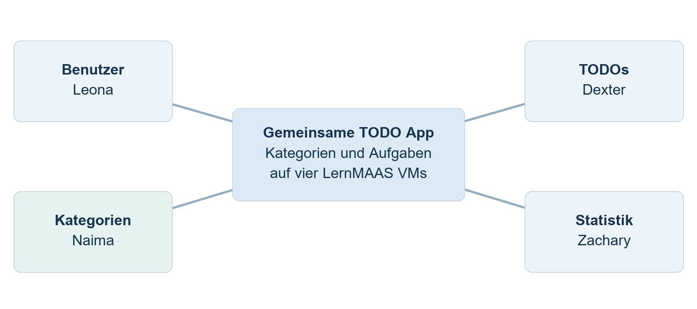
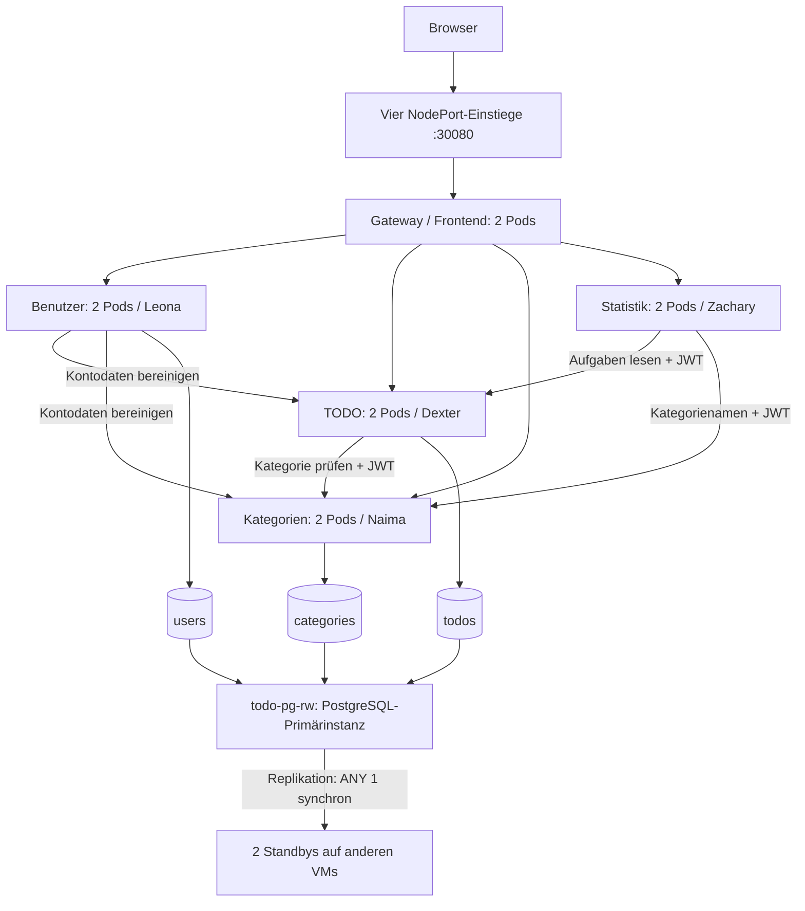

# Verteilte TODO-Applikation: Dokumentation LB2



| | |
|---|---|
| **Modul** | M321 Verteilte Systeme programmieren, TBZ, Klasse AP23a |
| **Gruppe** | Leona · Zachary · Naima · Dexter |
| **Repository** | https://github.com/dexter-zurbruegg/M321_LB2_Leona_Zachary_Naima_Dexter |
| **Branch mit dem finalen Stand** | `main` (vollständiger Stand aus `ha-cluster-repair`) |
| **Abgabe** | Projektarbeit 26.10.2026 · Testing und Demo 02.11.2026 |
| **Version** | 2.0 · Clusterstand, aktualisiert 26.10.2026 |

---

## Inhaltsverzeichnis

1. [Vorgehen (Projektplanung)](#1-vorgehen-projektplanung)
2. [Anforderungen und Features](#2-anforderungen-und-features)
3. [Verteiltes System im Überblick](#3-verteiltes-system-im-überblick)
4. [Systemkomponenten](#4-systemkomponenten)
   - 4.1 [Benutzer-Service (Leona)](#41-benutzer-service-leona)
   - 4.2 [TODO-Service (Dexter)](#42-todo-service-dexter)
   - 4.3 [Kategorien-Service (Naima)](#43-kategorien-service-naima)
   - 4.4 [Statistik-Service (Zachary)](#44-statistik-service-zachary)
   - 4.5 [Frontend (alle)](#45-frontend-alle)
   - 4.6 [Reverse Proxy / Loadbalancer (Dexter + Leona)](#46-reverse-proxy--loadbalancer-dexter--leona)
5. [Hochverfügbarkeit](#5-hochverfügbarkeit)
6. [Installation auf LernMAAS](#6-installation-auf-lernmaas)
7. [Tests (Übersicht)](#7-tests-übersicht)
8. [Fazit und Ausblick](#8-fazit-und-ausblick)
9. [Anhang](#9-anhang)

---

## 1. Vorgehen (Projektplanung)

Wir haben das Projekt nach dem Vorgehen aus dem Auftrag LB2 in sechs Phasen umgesetzt (Details in der [Planung](../planung_projektarbeit.md)):

| Phase | Ergebnis |
|---|---|
| 1. Planung und Schnittstellen | Anforderungen F01–F10 / N01–N08 priorisiert, Aufteilung in vier Services, Planung von der Lehrperson freigegeben. Danach API-Verträge in [schnittstellen.md](schnittstellen.md) festgelegt, **zuerst das JWT-Format**, weil alle anderen Services davon abhängen. |
| 2. Technisches Grundgerüst | Ordnerstruktur, ein Dockerfile pro Service, `/health`, eigene Datenbank pro Service, `docker compose` auf LernMAAS. HA-Konzept früh ausprobiert (zwei Instanzen hinter nginx). |
| 3. Pflichtfunktionen | Jede Person baut ihren Service und die passende Seite im Frontend, mit Tests. |
| 4. Integration | Reverse Proxy als einziger Einstieg, Service-Adressen per Umgebungsvariablen, ganzer Ablauf F09 getestet. |
| 5. HA und Ausfalltests | Zwei Instanzen pro Service + automatischer Neustart; Ausfalltests als Skript, Ergebnisse protokolliert. |
| 6. Abschluss | Fehler aus den Ausfalltests behoben (siehe Kapitel 5), Dokumentation konsolidiert; gemeinsame Demo noch zu proben. |

**Zusammenarbeit mit Git:** Jede Person arbeitet auf ihrem Branch `Feature-<Name>`, gemerged wird nach `develop`.
Der Clusterstand entstand auf `ha-cluster-repair` (App-Bezug `f74f737`) und wird vollständig nach `main` übernommen. `main` ist der Abgabezweig; `develop` kann älter sein. Reine Doku-Commits verändern den laufenden App-Code nicht.
Schnittstellenänderungen werden vorher mit allen abgestimmt, die die Schnittstelle benutzen (Tabelle in [schnittstellen.md §1.4](schnittstellen.md#14-aufrufe-zwischen-services-timeouts-ausfälle)).

**Technologieentscheid:** Der Auftrag erlaubt pro Komponente eine eigene Technologie. Wir haben uns trotzdem für **einen** Stack entschieden (Node.js 22 + Express 5, PostgreSQL 17, nginx).
So kann jede Person den Code der anderen lesen und bei Problemen helfen. Weil die Schnittstellen sauber über HTTP/JSON laufen, könnte man jeden Service trotzdem in einer anderen Sprache neu schreiben.

## 2. Anforderungen und Features

Priorität: **Muss** = Mindestumfang (muss für die Abgabe funktionieren). **Kann** = Zusatzfeature, erst nach den Muss-Anforderungen.
Die Testfall-IDs verweisen auf das [Testprotokoll](testprotokoll.md).

### 2.1 Funktionale Anforderungen

| ID | Anforderung | Prio | Komponente | Status | Nachweis |
|---|---|---|---|---|---|
| F01 | Benutzer erstellen, bearbeiten, löschen | Muss | Benutzer | ✅ | TC-U01–U03, U07, U08, U10 |
| F02 | Anmelden und Abmelden | Muss | Benutzer | ✅ | TC-U04–U06, U09 |
| F03 | Eigene TODOs erstellen, anzeigen, bearbeiten, löschen | Muss | TODO | ✅ | TC-T01–T03 |
| F04 | Status offen / in Bearbeitung / erledigt | Muss | TODO | ✅ | TC-T04 |
| F05 | Eigene Kategorien erstellen, bearbeiten, löschen | Muss | Kategorien | ✅ | TC-K01–K05 |
| F06 | TODO einer Kategorie zuordnen (max. 1) | Muss | TODO + Kategorien | ✅ | TC-T05–T07 |
| F07 | Anzahl offener und erledigter TODOs | Muss | Statistik | ✅ | TC-S01, S02 |
| F08 | Ø Zeit Erstellung → Erledigung, «Keine Daten» bei 0 | Muss | Statistik | ✅ | TC-S01, S03, Unit-Tests |
| F09 | Eine Weboberfläche verbindet alle vier Services | Muss | Frontend | ✅ | TC-E01; Demo vorgesehen |
| F10 | Verständliche Fehler- und Ladezustände | Muss | alle | ✅ | TC-U03; Browsernachweis; vollständige GUI-Prüfung offen |
| Z1 | Filter nach Status und Kategorie | Kann | TODO | ✅ | TC-T08 |
| Z2 | Suche nach TODO-Titel | Kann | TODO | ✅ | TC-T08 |
| Z3 | Prioritäten niedrig / mittel / hoch | Kann | TODO | ✅ | TC-T01, T03, T08 |
| Z4 | Farbe pro Kategorie | Kann | Kategorien | ✅ | TC-K01, K02, K04 |
| Z5 | Statistik pro Kategorie, «erledigt in den letzten 7 Tagen» | Kann | Statistik | ✅ | TC-S04, Unit-Tests |

Bewusst **nicht** umgesetzt (wie in der Planung): E-Mail-Erinnerungen, Teamfreigaben, Echtzeit-Synchronisation, wiederkehrende Aufgaben.

### 2.2 Nicht-funktionale Anforderungen

| ID | Anforderung | Prio | Umsetzung | Nachweis |
|---|---|---|---|---|
| N01 | 4 Services getrennt startbar, APIs dokumentiert | Muss | eigene `docker-compose.yml` pro Service, [schnittstellen.md](schnittstellen.md) | Compose-Dateien vorhanden; Kategorien-Einzelstart belegt |
| N02 | Nur eigene Daten (serverseitig) | Muss | `userId` nur aus dem geprüften JWT, jede SQL-Abfrage mit `user_id`, fremd = 404 | TC-T09, K06, S05 |
| N03 | Passwörter gehasht, keine Secrets im Repo | Muss | bcrypt (Kostenfaktor 10), `.env` in `.gitignore`, `init-env.sh` erzeugt Zufallswerte | TC-U01, Code-Review |
| N04 | Daten überleben Neustart | Muss | Drei replizierte PostgreSQL-Instanzen mit lokalen PersistentVolumes | Vier VM-Isolationen: bestätigte Daten erhalten |
| N05 | Läuft auf LernMAAS | Muss | MicroK8s auf vier LernMAAS-VMs | Kapitel 6 |
| N06 | 2 HA-Massnahmen + Ausfalltests | Muss | Getrennte App-Replikate, automatischer Ersatz und DB-Replikation | VM-11/13/16/17 vom 24.10. |
| N07 | Desktop + Mobile | Muss | responsives CSS (ab 640 px gestapelt) | Layout vorhanden; vollständiger aktueller Desktop-/Mobiltest offen |
| N08 | Doku für Installation, Konfiguration, APIs, Tests | Muss | README, schnittstellen.md, testprotokoll.md | – |

Die Statusangaben beziehen sich auf die genannten normalen API-Fälle. Sie bedeuten keine vollständige Abdeckung aller Fehlerfälle: Kontolöschung bei Teilfehlern, JWT-Vertragslücken und umfassende GUI-Prüfungen bleiben offen.

## 3. Verteiltes System im Überblick


Stand: 26.10.2026. Aktive Betriebsart: MicroK8s v1.35.6, Namespace `todo-app`.

| Person | VM / Knoten | Einstieg |
|---|---|---|
| Naima | 10.4.31.11 / m321-11-ap23a | http://10.4.31.11:30080 |
| Dexter | 10.4.31.13 / m321-13-ap23a | http://10.4.31.13:30080 |
| Leona | 10.4.31.16 / m321-16-ap23a | http://10.4.31.16:30080 |
| Zachary | 10.4.31.17 / m321-17-ap23a | http://10.4.31.17:30080 |



Die Datenbanksymbole sind drei **logische Datenbanken** innerhalb desselben PostgreSQL-Clusters. Jede der drei PostgreSQL-Instanzen hält eine Kopie dieses Datenbankverbunds. Statistik hat keine eigene Datenbank.


Die interne Kommunikation verwendet Kubernetes-Service-Namen, beispielsweise `http://category-service:3000`. Beim TODO-Anlegen prüft Dexter `GET /categories/{id}` mit dem Benutzer-JWT: 200 erlaubt, 404 führt zu 422, fehlende Erreichbarkeit zu 503. Prüfen und Speichern über zwei Services sind keine atomare Transaktion; konkurrierendes Löschen ist noch nicht umfassend getestet.

Zachary liest TODOs und Kategorienamen über die APIs. `includeDeleted=true` erhält historische Namen. Leona bereinigt bei Kontolöschung TODOs und Kategorien. Datenhaltung, Einstiegswechsel und Grenzen sind in der [Architektur](architektur.md) erklärt.

## 4. Systemkomponenten

> Jede Person ist für ihr Kapitel verantwortlich (Einzelbewertung). Der Auftrag verlangt keine separate persönliche Abgabedatei. Die folgenden Kapitel und ihre Vertiefungen sind gemeinsam strukturiert; jede Person prüft ihre fachlichen Aussagen und erläutert ihren tatsächlichen Beitrag.

### 4.1 Benutzer-Service (Leona)

**Zweck:** Konten verwalten und Anmeldung. Er ist die einzige Komponente, die Passwörter kennt, und die einzige, die Tokens ausstellt.

**Technik:** Node.js 22, Express 5, `bcryptjs` (Passwort-Hash), `jsonwebtoken` (JWT), PostgreSQL-Datenbank `users`.

**Datenmodell**

| Feld | Typ | Bemerkung |
|---|---|---|
| `id` | uuid | Primärschlüssel, von PostgreSQL erzeugt |
| `email` | text, eindeutig | wird klein geschrieben gespeichert |
| `password_hash` | text | bcrypt-Hash, Kostenfaktor 10. Das Passwort selbst wird nie gespeichert |
| `display_name` | text | 1–50 Zeichen |
| `created_at`, `updated_at` | timestamptz | |

**Endpunkte:** `POST /users`, `POST /auth/login`, `POST /auth/logout`, `GET/PATCH/DELETE /users/me` (Details: [schnittstellen.md §2](schnittstellen.md#2-benutzer-service-leona)).

**Wichtige Abläufe und Entscheide**

- **Login:** E-Mail suchen, `bcrypt.compare` mit dem Hash. Bei Erfolg wird ein JWT signiert (`HS256`, `sub` = userId, `iss` = `user-service`, 1 h gültig).
  Bei unbekannter E-Mail und bei falschem Passwort kommt **dieselbe** Meldung. So verrät der Service nicht, welche Konten existieren.
- **JWT-Format** zuerst festgelegt, weil alle anderen Services davon abhängen. Jeder Service besitzt eine eigene Prüfung (`src/auth.js`). Benutzer- und TODO-Service erzwingen erforderliches `exp` und gültiges UUID-`sub` noch nicht gleich streng wie Kategorien und Statistik. Das bleibt offen.
- **Profil ändern:** Für eine neue E-Mail oder ein neues Passwort braucht es das aktuelle Passwort. So kann jemand mit einem gestohlenen Token das Konto nicht übernehmen.
- **Konto löschen (Regel 5.3.3):** Der Service ruft zuerst `DELETE /todos` und `DELETE /categories` mit dem Token des Benutzers auf, danach löscht er das Konto.
  Bei einer fehlgeschlagenen Abhängigkeit kann 503 zurückkommen. Bereits entfernte TODOs werden bei einem späteren Fehler nicht zurückgerollt. Es gibt keine serviceübergreifende Transaktion; Wiederholbarkeit und Teilfehlerbehandlung sind noch abzusichern.
- **Abmelden:** Das JWT ist zustandslos. Das Frontend löscht es. Grenze: Ein kopiertes Token bleibt bis zum Ablauf (max. 1 h) gültig. Abhilfe wäre eine Sperrliste, die für dieses Projekt zu aufwendig ist.

**Fehlerbehandlung:** 400 (Validierung), 401 (Login/Token), 403 (aktuelles Passwort falsch), 409 (E-Mail vergeben), 503 (beim Löschen ein Service weg).

**Tests:** Unit-Tests JWT-Prüfung (`services/user-service/test/auth.test.js`, 4 Fälle), API-Tests TC-U01–U10 (`tests/api/user.test.js`).

### 4.2 TODO-Service (Dexter)

**Zweck:** TODOs der Benutzer verwalten: erstellen, anzeigen, bearbeiten, löschen, Status, Priorität und Kategorie.

**Technik:** Node.js 22, Express 5, PostgreSQL-Datenbank `todos`.

**Datenmodell**

| Feld | Typ | Bemerkung |
|---|---|---|
| `id` | uuid | |
| `user_id` | uuid | aus dem JWT, nie aus dem Request |
| `title` / `description` | text | 1–200 / max. 2000 Zeichen |
| `status` | text | `open`, `in_progress`, `done` (CHECK-Constraint) |
| `priority` | text | `low`, `medium`, `high` |
| `category_id` | uuid, nullable | **kein Fremdschlüssel**: die Kategorien liegen in einer anderen Datenbank |
| `created_at`, `updated_at`, `completed_at` | timestamptz | `completed_at` nur bei Status `done` |

**Endpunkte:** `GET/POST /todos`, `GET/PATCH/DELETE /todos/{id}`, `DELETE /todos` (Details: [schnittstellen.md §3](schnittstellen.md#3-todo-service-dexter)).

**Wichtige Abläufe und Entscheide**

- **Status und Erledigungszeit (Regel 5.3.4):** Die Funktion `completedAtFor()` in `src/status.js` entscheidet: auf `done` gesetzt → `completedAt` = jetzt. Weg von `done` → `null`. Schon `done` → Zeitpunkt bleibt. Die Funktion ist rein und deshalb einzeln getestet.
- **Kategorie prüfen (F06, Regel 5.3.1):** Bei `categoryId` fragt der Service `GET /categories/{id}` beim Kategorien-Service, mit dem Token des Benutzers.
  `200` → erlaubt. `404` → `422 CATEGORY_NOT_FOUND`. Nicht erreichbar → `503`. Geprüft wird nur, wenn sich die Kategorie **ändert**.
  So bleibt ein TODO, dessen Kategorie gelöscht wurde, weiterhin bearbeitbar (Regel 5.3.2).
- **Ausfall des Kategorien-Service (Regel 5.3.5):** TODOs anzeigen, bearbeiten und ohne Kategorie erstellen funktioniert weiter. Nur das Zuordnen einer Kategorie ist kurz nicht möglich.
- **Filter, Suche, Sortierung (Z1–Z3):** `?status=`, `?priority=`, `?categoryId=`, `?q=` (Suche mit `ILIKE`, die Platzhalter `%` und `_` werden maskiert).
  Sortiert wird so: unerledigte zuerst, dann nach Priorität, dann neueste zuerst.
- **Sicherheit:** Jede SQL-Abfrage hat `WHERE id = $1 AND user_id = $2` mit Parametern (keine SQL-Injection). Fremde TODOs → 404.

**Tests:** Unit-Tests Statuslogik (`test/status.test.js`, 3 Fälle), API-Tests TC-T01–T10 (`tests/api/todo.test.js`).

### 4.3 Kategorien-Service (Naima)

**Zweck:** Kategorien der Benutzer verwalten und dem TODO-Service sagen, ob eine Kategorie benutzt werden darf.

**Technik:** Node.js 22, Express 5, PostgreSQL-Datenbank `categories`.

**Datenmodell**

| Feld | Typ | Bemerkung |
|---|---|---|
| `id` | uuid | |
| `user_id` | uuid | aus dem JWT |
| `name` | text | 1–40 Zeichen, pro Benutzer eindeutig (nur aktive, Gross-/Kleinschreibung egal) |
| `color` | text | `#rrggbb`, Standard `#2f6fed` |
| `created_at`, `updated_at` | timestamptz | |
| `deleted_at` | timestamptz, nullable | gesetzt = gelöscht (Soft-Delete) |

**Endpunkte:** `GET/POST /categories`, `GET/PATCH/DELETE /categories/{id}`, `DELETE /categories` (Details: [schnittstellen.md §4](schnittstellen.md#4-kategorien-service-naima)).

**Wichtige Abläufe und Entscheide**

- **Soft-Delete (Regel 5.3.2):** Löschen setzt nur `deleted_at`. Bestehende TODOs behalten ihre Kategorie, das Frontend zeigt sie durchgestrichen.
  Der Prüf-Endpunkt und die normale Liste kennen gelöschte Kategorien nicht mehr. Deshalb sind neue Zuordnungen nicht möglich.
  `?includeDeleted=true` liefert sie trotzdem, damit Frontend und Statistik Namen anzeigen können.
- **Prüf-Endpunkt für den TODO-Service:** `GET /categories/{id}` antwortet nur mit 200, wenn die Kategorie **dem anfragenden Benutzer gehört und aktiv ist**. Sonst 404.
  Weil der TODO-Service das Token des Benutzers weitergibt, braucht es kein zusätzliches Service-Passwort.
- **Eindeutige Namen:** Ein *partieller* Index `UNIQUE (user_id, lower(name)) WHERE deleted_at IS NULL` sorgt dafür: «Schule» und «schule» gehen nicht beide.
  Nach dem Löschen ist der Name wieder frei. Der Konflikt kommt als PostgreSQL-Fehler `23505` und wird zu `409 CATEGORY_EXISTS`.
- **Keine zweite Zuordnungsliste (Regel 5.3.1):** Welche TODOs zu einer Kategorie gehören, weiss nur der TODO-Service. Damit gibt es keine doppelten Daten, die auseinanderlaufen könnten.

**Tests:** API-Tests TC-K01–K07 (`tests/api/category.test.js`). Zusätzlich 10/10 JWT-Regressionstests. Ausführliche Umsetzung, Installation, Grenzen und offene Testfälle: [Naimas Komponentenbeschreibung](naima-umsetzung-tests.md).

### 4.4 Statistik-Service (Zachary)

**Zweck:** Auswertung der TODOs eines Benutzers: Anzahl nach Status (F07), Ø Erledigungsdauer (F08), Auswertung pro Kategorie und «erledigt in den letzten 7 Tagen».

**Technik:** Node.js 22, Express 5. **Keine eigene Datenbank.** Er holt die Daten bei jeder Anfrage über die APIs von TODO- und Kategorien-Service.
Vorteil: Die Zahlen sind immer aktuell, es gibt keine Kopie, die veraltet. Nachteil: Ohne TODO-Service gibt es keine Statistik (siehe HA-05).

**Endpunkt:** `GET /stats` (Details: [schnittstellen.md §5](schnittstellen.md#5-statistik-service-zachary)).

**Wichtige Abläufe und Entscheide**

- **Parallel abfragen:** TODOs und Kategorien werden gleichzeitig geholt (`Promise.all`). Das spart Wartezeit.
- **Berechnung getrennt von HTTP:** Die Logik steckt in `src/stats.js` als reine Funktionen (`countByStatus`, `averageCompletionSeconds`, `byCategory`). Sie sind ohne Netzwerk testbar.
- **Durchschnitt (F08, Regel 5.3.4):** Mittelwert von `completedAt − createdAt` in Sekunden über alle **aktuell** erledigten TODOs. Wieder geöffnete zählen nicht.
  Keine erledigten TODOs → `null` → Frontend zeigt «Keine Daten».
- **Teilausfall:** Fällt der Kategorien-Service aus, liefert der Statistik-Service trotzdem alle Zahlen, nur ohne Kategorienamen (`categoriesAvailable: false`).
  Fällt der TODO-Service aus, kommt nach begrenzten Aufrufversuchen eine verständliche 503-Meldung (2 s pro Versuch; keine pauschale 2-s-Garantie für die gesamte Anfrage), statt dass die Anfrage hängt.

**Tests:** Unit-Tests der Berechnung (`test/stats.test.js`, 7 Fälle mit bekannten Zeitwerten), API-Tests TC-S01–S05 (`tests/api/stats.test.js`).

### 4.5 Frontend (alle)

**Zweck:** eine Weboberfläche für alle vier Services (F09), verständliche Meldungen (F10), Desktop und Mobile (N07).

**Technik:** HTML, CSS, JavaScript-Module ohne Framework und ohne Build-Schritt. nginx liefert es aus.

| Datei | Inhalt | Verantwortlich |
|---|---|---|
| `js/api.js` | gemeinsamer API-Client: hängt das JWT an, übersetzt Fehler in Meldungen, meldet bei 401 ab | gemeinsam |
| `js/app.js` | Router (`#/todos`, …), Navigation, nur angemeldet erreichbar | gemeinsam |
| `js/ui.js`, `css/style.css` | Helfer (Meldungen, Ladeanzeige, HTML-Escaping), einheitliches Layout | gemeinsam |
| `js/pages/auth.js`, `account.js` | Anmelden, Registrieren, Konto | Leona |
| `js/pages/todos.js` | TODO-Liste, Formular, Filter, Suche | Dexter |
| `js/pages/categories.js` | Kategorien mit Farbe | Naima |
| `js/pages/stats.js` | Kennzahlen, Tabelle pro Kategorie | Zachary |

- **Lade- und Fehlerzustände (F10):** Während eines Requests sind Buttons gesperrt und eine Ladeanzeige läuft. Fehler zeigen die `message` des Services («E-Mail oder Passwort ist falsch»).
  Netzwerkfehler zeigen «Server nicht erreichbar …». Fehlen die Kategorien, kommt ein Hinweis, die TODOs bleiben benutzbar.
- **Sicherheit:** Alle Benutzereingaben werden vor der Anzeige escaped (`esc()`), das reduziert HTML-Injection an diesen Ausgabestellen; eine vollständige XSS-Prüfung ist damit nicht belegt. Das Token liegt im `localStorage` und wird beim Abmelden gelöscht.


### 4.6 Reverse Proxy / Loadbalancer (Dexter + Leona)

nginx liefert das Frontend und leitet `/api/auth`, `/api/users`, `/api/todos`, `/api/categories`, `/api/stats` weiter. Zwei Gateway-Pods stehen hinter NodePort 30080. Im Cluster zeigen die Upstreams auf Kubernetes-Service-Namen; Kubernetes verteilt auf bereite Pods. Feste einzelne Containeradressen gehören zur lokalen Compose-Variante.

Der Proxy setzt `X-Request-Id`, Services geben `X-Instance` zurück und protokollieren JSON. Verbindungsfehler/Timeouts erlauben begrenzte Versuche; Service-Antworten mit 503 werden vom Gateway nicht pauschal erneut versandt. Laufende Anfragen können bei einem Ausfall scheitern.

`frontend/runtime-config.js` enthält vier API-Einstiege. Die geladene Oberfläche kann einen gesunden Einstieg wählen; unklare Schreiboperationen werden nicht blind wiederholt. CORS erlaubt die vier Team-Ursprünge. Erster Seitenaufruf oder Reload einer ausgefallenen Adresse benötigt eine Ersatzadresse.

## 5. Hochverfügbarkeit

### Massnahmen

1. Zwei Replikate je App-Service und Gateway mit erforderlicher Anti-Affinität über verschiedene VMs; Readiness nimmt nicht bereite Pods aus dem Verkehr.
2. Deployments ersetzen fehlende Pods; Liveness erkennt Prozessprobleme. `/health` prüft bei den drei datenhaltenden Services zusätzlich die DB; bei Statistik den Prozess.
3. CloudNativePG betreibt drei PostgreSQL-Instanzen mit synchroner Bestätigung durch mindestens einen Standby. Bei Primärausfall ist Umschaltung möglich.
4. Zwei CoreDNS- und zwei Operator-Replikate reduzieren weitere Ausfallpunkte. Korrigierte dqlite-Steuerung und koordinierter Watchdog sichern die beobachteten Wiederherstellungsabläufe ab.

### Daten und Steuerungsebene

Lokale Volumes verwenden `m321-local`, Retain und `/var/snap/microk8s/common/m321-postgres`. Datenkopien liegen im geprüften Stand auf .11, .13 und .16; .17 hat ein Reserve-Volume. Lokale Volumes bleiben an ihre VM gebunden; Ausfallschutz nutzt vorhandene replizierte Kopien auf anderen VMs, kein gemeinsames Netzwerk-Dateisystem.

Frühe VM-Isolationen deckten hängende dqlite-Watches auf. Eingesetzt wurde v1.8.1 mit Upstream-Patch 365 und ein Watchdog für echte Schreib-/Watch-Prüfungen mit koordinierter Wiederherstellung. Build, Prüfsumme, Hosteinstellungen und Diagnose stehen in der [Betriebsanleitung](betrieb-cluster.md). Die bestandenen Messungen gelten für diese korrigierte Konfiguration.

### Nachweis und Grenzen

Am 24.10. wurde jede VM einzeln etwa zwei Minuten im IPv4-Netz isoliert. Nach Umschaltung waren vollständige Abläufe schon während der Trennung möglich. Alle 167 bestätigten Testkategorien blieben erhalten; längste beobachtete Fehlerphase etwa 81 s. Dies ist kein physischer Stromausfall und kein unterbrechungsfreier Betrieb. [Messwerte und Testkriterien](testprotokoll.md).

Eine gemeinsame ausfallsichere Einstiegs-URL, gleichzeitiger Mehrfachausfall, Wiederherstellung nach Datenträgerverlust und Backup-Restore sind nicht nachgewiesen. Replikation ersetzt kein Backup. Alte Compose-Neustartzeiten unter zwei Sekunden sind keine VM-Umschaltzeiten.

## 6. Installation auf LernMAAS

Aktive Manifeste: `deploy/ha`. Repository auf allen VMs: `/home/ubuntu/m321-ha-20261024/repository`. Einstieg im Schulnetz/VPN: `http://10.4.31.11:30080` oder .13/.16/.17. [Betriebsanleitung mit Installationsvoraussetzungen](betrieb-cluster.md).

```bash
microk8s kubectl get nodes
microk8s kubectl -n todo-app get deployments
microk8s kubectl -n todo-app get cluster todo-pg
microk8s kubectl -n todo-app get pvc
microk8s kubectl apply --dry-run=server -k deploy/ha
```

Die bestehende Installation ist geprüft. Neuaufbau benötigt zusätzlich Operator/CRDs, Images auf allen Nodes, Secrets, Storage-Pfade, Datenmigration und Hostkorrekturen. Ein vollständiger Neuaufbau wurde nicht erneut durchgeführt. `scripts/k8s-deploy.sh` und `deploy/k8s` beschreiben die ältere Einzel-Datenbank-Variante und dürfen diesen Cluster nicht ersetzen. Docker Compose bleibt separate Entwicklung auf Port 8080.

## 7. Tests (Übersicht)

| Prüfung | Ergebnis / Datum |
|---|---|
| API: Benutzer 10, TODO 10, Kategorien 7, Statistik 5, Ablauf 3 | 35/35 bestanden, 24.10. und erneut 26.10. |
| Kategorien-JWT | 10/10 bestanden, 24.10. |
| Einzelne VM-Netzisolationen | 4/4; 167 bestätigte Kategorien erhalten, 24.10. |
| Clusterzustand | Vier Ready-Nodes, fünf Deployments 2/2, PostgreSQL 3/3 healthy, 26.10. |
| Kategorie-Einzelstack vor Migration | 6/6 historische Prüfungen; Prozess-/DB-Neustart nicht mit VM-Ausfall gleichsetzen |
| Vollständige aktuelle GUI-/Mobilprüfung und Codeabdeckung | Noch offen |

[Testprotokoll](testprotokoll.md): Definitionen, Umgebung, Ergebnisse, Rohbelege und Grenzen. [Präsentation](praesentation.md): vorgesehener Ablauf. Testzahlen sind kein Coverage-Prozentsatz.

## 8. Fazit und Ausblick

Die Kernfunktionen arbeiten im gemeinsamen Cluster über die vereinbarten APIs zusammen. Der wesentliche Fortschritt gegenüber lokalen Einzelstacks ist die Verteilung über vier VMs mit replizierter Datenhaltung. Tests zeigen Wiederherstellung während einer andauernden Einzel-VM-Störung; die gemessene Unterbrechung bleibt eine Grenze.

| Offen | Zuständigkeit / Abschlusskriterium |
|---|---|
| JWT-Vertrag einheitlich erzwingen | Leona/Dexter: UUID-sub und erforderliches endliches exp ergänzen und testen |
| Kontolöschung bei Teilfehlern | Leona mit betroffenen Services: wiederholbarer Ablauf, Tests und korrekte Fehlerbeschreibung |
| Persönliche Kapitel prüfen | Jede Person versteht und verantwortet ihr Kapitel; persönliche Reflexion nicht stellvertretend erfinden |
| Weitere Tests | Naima: Grenzfälle, Readiness-/GUI-/Mobilfälle und Coverage; andere verantworten eigene Tests |
| Demo proben | Alle: Rollen, Ablauf, Ausfall und Rückkehr zum gesunden Zustand üben |
| Ausbau | Gemeinsame ausfallsichere URL, kürzere gemessene Umschaltphase, Backup-Restore, Monitoring |

## 9. Anhang

### Quellen und Nachweise

- [Offizieller Auftrag und Raster](https://gitlab.com/ch-tbz-it/Stud/m321/m321/-/blob/KES/Auftrag%20LB2.md), nochmals geprüft 26.10.: gemeinsame Doku mit individuell verantworteten Komponenten; finalen Branch angeben.
- [Schulportal](https://tbz.gloke.ch/ap23a_m321/), Termine geprüft 25.10.; genaue Teams-Abgabefrist beachten.
- [Schnittstellen](schnittstellen.md), [Tests](testprotokoll.md), [Betrieb](betrieb-cluster.md), [Planung](../planung_projektarbeit.md).
- [dqlite Upstream PR 365](https://github.com/canonical/k8s-dqlite/pull/365); Patch und Build-Hinweise im Repository.
- [Rohbelege 24.10.](nachweise-2026-10-24.txt), [Cluster 24.10.](cluster-2026-10-24.txt), [Einzelservice historisch](kategorien-einzelservice.txt), [API 26.10.](api-2026-10-26.txt).


Browsernachweis vom 24.10. Frühere Desktop-/Mobilbilder in `docs/img` ersetzen keine neue vollständige GUI-Abnahme.

Hilfsmittel: Die bisherige Doku nennt Claude (Anthropic). Für Bestandsprüfung, Clusterkorrekturen, Tests und aktuelle Doku wurde zusätzlich Codex verwendet. Aussagen sind anhand von Code, Konfiguration und Protokollen nachvollziehbar; individuelle Arbeit und Verständnis bleiben bei den Verantwortlichen.
