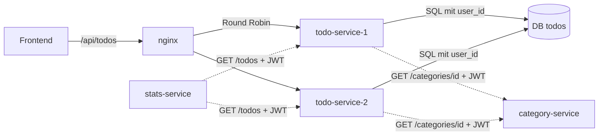

# Erklär-Doku Dexter: TODO-Service + Gateway (nginx)

> **TL;DR:** Dein Service ist das Herz der App: TODOs anlegen, ändern, löschen, Status, Priorität, Kategorie, Filter und Suche.
> Beim Zuordnen einer Kategorie **fragt er Naimas Service**, ob die Kategorie dem Benutzer gehört. Zacharys Statistik **liest deine TODOs** über deine API.
> Mit Leona gehört dir der **Reverse Proxy**: nginx verteilt die Anfragen auf je zwei Instanzen und weicht bei Ausfall aus.

**Termine:** Abgabe 26.10.2026 · Demo + Testing 02.11.2026

## 1. Was dein Teil macht

| Endpunkt | Was |
|---|---|
| `GET /todos?status=&priority=&categoryId=&q=` | eigene TODOs, gefiltert/gesucht, sortiert (F03, Z1, Z2) |
| `POST /todos` | erstellen (F03, F06, Z3) |
| `GET/PATCH/DELETE /todos/{id}` | lesen, ändern (inkl. Status F04 und Kategorie F06), löschen |
| `DELETE /todos` | alle eigenen löschen (ruft Leonas Service beim Konto löschen auf) |

## 2. Wie es funktioniert



**Status-Regel (5.3.4):** `open` → `done` setzt `completedAt` = jetzt. `done` → `open`/`in_progress` setzt `completedAt` = `null`.
Daraus rechnet Zachary die Ø-Erledigungsdauer.

**Kategorie-Regel (5.3.1/5.3.2):** Du speicherst nur die `categoryId`. Ob sie gültig ist, weiss nur Naimas Service. Deshalb fragst du dort nach.

## 3. Code-Walkthrough

| Datei | Inhalt |
|---|---|
| `services/todo-service/src/app.js` | alle Endpunkte, Validierung, `checkCategory()` |
| `src/status.js` | `completedAtFor()`: die Status-Regel als reine Funktion |
| `src/server.js` | Tabelle `todos` (Status mit `CHECK`-Constraint, `category_id` **ohne** Fremdschlüssel) |
| `src/client.js` | `callService()`: Aufruf mit 2 s Timeout und einem zweiten Versuch |
| `gateway/templates/default.conf.template` | nginx-Konfiguration |
| `frontend/js/pages/todos.js` | deine Seite |

**Statusregel** (`status.js`):

```js
function completedAtFor(oldStatus, newStatus, oldCompletedAt, now = new Date()) {
  if (newStatus !== 'done') return null;          // offen / in Bearbeitung → nicht erledigt
  if (oldStatus === 'done') return oldCompletedAt; // war schon erledigt → Zeitpunkt behalten
  return now;                                      // jetzt erledigt
}
```

**Kategorie prüfen** (`app.js`):

```js
const res = await callService('Der Kategorien-Service', `${CATEGORY_URL}/categories/${categoryId}`, { token: req.token, requestId: req.id });
if (res.status === 404) throw new HttpError(422, 'CATEGORY_NOT_FOUND', 'Diese Kategorie existiert nicht oder wurde gelöscht');
```

Du schickst das **Token des Benutzers** mit. Dadurch antwortet Naimas Service nur mit 200, wenn die Kategorie *diesem* Benutzer gehört.
Ist ihr Service ganz weg, wirft `callService` nach spätestens 2 s einen `503` mit verständlicher Meldung.

**Nur prüfen, wenn sich die Kategorie ändert** (`PATCH`):

```js
if (body.categoryId !== undefined && body.categoryId !== todo.category_id) categoryId = await checkCategory(req, body.categoryId);
```

So kann man ein TODO, dessen Kategorie gelöscht wurde, trotzdem noch erledigen (Test TC-T07).

**Nur eigene Daten (N02):** jede Abfrage mit beiden Bedingungen:

```js
pool.query('SELECT * FROM todos WHERE id = $1 AND user_id = $2', [req.params.id, req.user.id]);
```

**Suche sicher machen:** `?q=` wird zu `title ILIKE '%…%'`. `%` und `_` aus der Eingabe werden maskiert, sonst wäre `%` ein Platzhalter für alles (TC-T08).

### Gateway (nginx), gemeinsam mit Leona

```nginx
upstream todo_service {
    zone todo_service 64k;
    server ${TODO_UPSTREAM_1} resolve max_fails=1 fail_timeout=3s;   # todo-service-1:3000
    server ${TODO_UPSTREAM_2} resolve max_fails=1 fail_timeout=3s;   # todo-service-2:3000
}
proxy_next_upstream error timeout;   # Verbindung abgelehnt / Timeout → andere Instanz
proxy_connect_timeout 1s;
location /api/todos { rewrite ^/api(/.*)$ $1 break; proxy_pass http://todo_service; }
```

- `${…}` füllt das nginx-Image beim Start aus Umgebungsvariablen ein (Template). So funktioniert dieselbe Datei in Compose, Kubernetes und auf mehreren VMs.
- `max_fails=1 fail_timeout=3s`: Nach einem Fehler wird die Instanz 3 s lang übersprungen.
- **Nicht** bei `503` wiederholen: Ein 503 bedeutet «meine Abhängigkeit ist weg», die andere Instanz hätte dasselbe Problem.

## 4. So demonstrierst du es

1. TODO mit Kategorie und Priorität «Hoch» anlegen → erscheint oben mit Badges.
2. Status auf «Erledigt» → durchgestrichen, «erledigt …» mit Zeit, rutscht nach unten.
3. Filter «Erledigt» und Suche zeigen.
4. **Lastverteilung live zeigen:**
   ```bash
   for i in 1 2 3 4; do curl -s -o /dev/null -D - http://<vm>:8080/api/health/todo | grep -i x-instance; done
   ```
   → abwechselnd zwei verschiedene Container-IDs.
5. **Ausfall einer Instanz:** `docker stop todo-service-1` → im Browser weiterarbeiten, alles geht. `docker start todo-service-1`.

## 5. Fragen der Lehrperson und Antworten

**Warum ist `category_id` kein Fremdschlüssel?** Die Kategorien liegen in einer anderen Datenbank (Naimas Service). Ein Fremdschlüssel geht nur innerhalb einer DB.
Die Konsistenz sichern wir über die API-Prüfung beim Speichern. Das ist typisch für Microservices («database per service»).

**Was passiert, wenn der Kategorien-Service ausfällt?** Anzeigen, Bearbeiten und Erstellen ohne Kategorie gehen weiter. Nur «mit Kategorie speichern» meldet nach max. 2 s einen verständlichen 503 (Test HA-04).

**Warum 404 bei fremden TODOs und nicht 403?** 403 würde verraten, dass es das TODO gibt. 404 sagt nichts.

**Wie verteilt nginx die Last?** Round Robin: abwechselnd. Fällt eine Instanz aus (Verbindungsfehler/Timeout), probiert nginx im selben Request die andere und überspringt die kaputte 3 s lang.

**Warum zwei feste `server`-Einträge statt einem DNS-Namen?** Zuerst hatten wir einen Namen, der beide Instanzen auflöst. Beim Test ging 1 von 20 Anfragen verloren: Ein nginx-Prozess kannte noch eine alte DNS-Antwort mit nur einer Instanz und konnte nicht ausweichen.
Mit zwei festen Einträgen hat nginx immer eine Alternative (Testprotokoll §9, Fehler 1).

**Was ist der Unterschied zwischen Reverse Proxy und Loadbalancer?** Ein Reverse Proxy nimmt Anfragen stellvertretend für Server an und leitet sie weiter (ein Einstieg, Routing nach Pfad). Ein Loadbalancer verteilt auf mehrere gleiche Server. nginx macht hier beides.

**Ist der Proxy selbst ein Single Point of Failure?** In Compose ja. Er startet aber automatisch neu (`restart: always`). In Kubernetes laufen zwei Gateway-Pods hinter dem NodePort.

**Warum `PATCH` und nicht `PUT`?** `PATCH` ändert nur die mitgeschickten Felder (z. B. nur den Status). `PUT` würde das ganze Objekt ersetzen.

## 6. Deine Tests

- Unit: `services/todo-service/test/status.test.js` → `npm test`
- API: `tests/api/todo.test.js` TC-T01–T10
- HA: HA-01, HA-02 (`scripts/ha-test.sh`) betreffen deinen Service und das Gateway.

## 7. Vor der Abgabe selbst tun

- [ ] Kapitel 4.2 + 4.6 in `docs/dokumentation.md` lesen und in eigenen Worten anpassen.
- [ ] `docker stop todo-service-1` selbst ausprobieren und im nginx-Log sehen, wohin die Anfragen gehen: `docker logs gateway --tail 20`.
