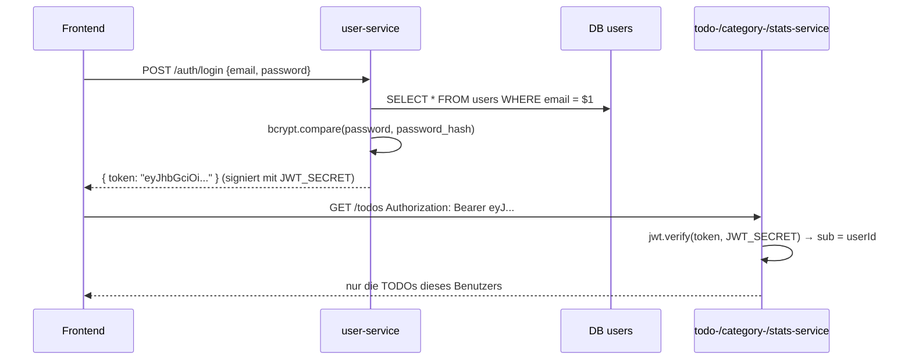

# Erklär-Doku Leona: Benutzer-Service + Login (JWT)

Stand 26.10.2026: ergänzende Lernhilfe; [gemeinsame Doku](dokumentation.md), [Betrieb](betrieb-cluster.md) und [aktuelle Tests](testprotokoll.md) sind massgebend. Individuelle Aussagen selbst prüfen; keine persönliche Durchführung wird ergänzt.

> **TL;DR:** Dein Service verwaltet Konten und stellt beim Login ein **JWT** aus: ein signierter «Ausweis», den das Frontend bei jedem Aufruf mitschickt.
> Alle anderen Services prüfen diesen Ausweis selbst und nehmen die Benutzer-ID daraus. Passwörter speicherst du nur als **bcrypt-Hash**.
> Zusätzlich gehört dir (mit Dexter) der Reverse Proxy und im Frontend die Seiten Anmelden, Registrieren und Konto.

**Termine:** Abgabe 26.10.2026 · Demo + Testing 02.11.2026

## 1. Was dein Teil macht

| Endpunkt | Was |
|---|---|
| `POST /users` | Registrieren (F01) |
| `POST /auth/login` | Anmelden → JWT (F02) |
| `POST /auth/logout` | Abmelden (das Frontend löscht das Token) |
| `GET /users/me` · `PATCH /users/me` | Profil lesen / ändern (F01) |
| `DELETE /users/me` | Konto löschen inkl. aller TODOs und Kategorien (F01, Regel 5.3.3) |

## 2. Wie es funktioniert



**Das JWT** besteht aus drei Teilen, getrennt durch Punkte: `Header.Payload.Signatur`.
Header und Payload sind nur Base64-kodiert, also **lesbar, aber nicht änderbar**. Ändert jemand etwas, passt die Signatur nicht mehr.
Die Signatur kann nur erzeugen, wer das `JWT_SECRET` kennt. Unser Payload:

```json
{ "sub": "<userId>", "email": "lea@example.com", "iat": 1792483200, "exp": 1792486800, "iss": "user-service" }
```

## 3. Code-Walkthrough

| Datei | Inhalt |
|---|---|
| `services/user-service/src/app.js` | alle Endpunkte |
| `src/auth.js` | `requireAuth`: Token aus Header lesen, prüfen, `req.user` setzen. **In allen Services identisch** |
| `src/server.js` | Tabelle anlegen (`CREATE TABLE IF NOT EXISTS users …`), Server starten |
| `src/client.js` | Aufruf anderer Services mit Timeout (für Konto löschen) |
| `src/db.js`, `src/http.js`, `src/health.js` | DB-Verbindung, Fehlerformat + Logs, `/health` (in jedem Service gleich) |
| `frontend/js/pages/auth.js`, `account.js` | deine Seiten im Frontend |

**Registrieren: das Passwort wird gehasht** (`app.js`):

```js
const hash = await bcrypt.hash(password, 10);   // 10 = Kostenfaktor: 2^10 Runden, absichtlich langsam
await pool.query('INSERT INTO users (email, password_hash, display_name) VALUES ($1, $2, $3) RETURNING *', [email, hash, displayName]);
```

`$1, $2, $3` sind **Parameter**: PostgreSQL setzt die Werte sicher ein, so ist SQL-Injection unmöglich.
Doppelte E-Mail → PostgreSQL-Fehler `23505` (unique violation) → wir antworten `409 EMAIL_TAKEN`.

**Login: Token ausstellen:**

```js
if (!user || !(await bcrypt.compare(password, user.password_hash))) {
  throw new HttpError(401, 'INVALID_CREDENTIALS', 'E-Mail oder Passwort ist falsch');   // gleiche Meldung für beides!
}
const token = jwt.sign({ sub: user.id, email: user.email }, SECRET, { algorithm: 'HS256', expiresIn: 3600, issuer: 'user-service' });
```

**Token prüfen** (`auth.js`, läuft in jedem Service vor jedem geschützten Endpunkt):

```js
const payload = jwt.verify(token, SECRET, { algorithms: ['HS256'], issuer: 'user-service' });
req.user = { id: payload.sub };   // DIE Quelle für die userId. Nie aus dem Body!
```

`algorithms: ['HS256']` ist wichtig: So kann niemand ein Token mit `alg: none` unterschieben.

**Konto löschen:** zuerst die Daten bei den anderen Services, dann das Konto:

```js
await callService('Der TODO-Service', `${TODO_URL}/todos`, { method: 'DELETE', token: req.token, requestId: req.id });
await callService('Der Kategorien-Service', `${CATEGORY_URL}/categories`, opts);
await pool.query('DELETE FROM users WHERE id = $1', [req.user.id]);
```

Ist ein Service weg, wirft `callService` einen 503-Fehler. Das Konto bleibt dann bestehen, bereits erfolgreiche Löschschritte werden bei späterem Fehler nicht zurückgerollt.

**Reverse Proxy (mit Dexter):** Lies Dexters Erklär-Doku Abschnitt «Gateway». Du solltest erklären können: `/api/auth/` geht an `user_service`, und dort gibt es zwei Server.

## 4. So demonstrierst du es

Folge dem [gemeinsamen Demoablauf](praesentation.md) auf Port 30080. Zeige deinen fachlichen Ablauf, die verwendete API und die aktuelle Pod-Platzierung. Verwende entbehrliche Testkonten, keine echten Tokens auf externen Webseiten. Ausfallprüfungen nur im geprobten Cluster-Szenario; alte Docker-Stop-Befehle steuern den aktiven Cluster nicht.

## 5. Fragen der Lehrperson und Antworten

**Warum JWT und nicht Sessions?**
Bei Sessions müsste jede Instanz jedes Services den Session-Speicher kennen (oder den Benutzer-Service fragen). Mit JWT prüft jeder Service das Token selbst.
Es gibt keinen gemeinsamen Zustand, deshalb funktionieren zwei Instanzen ohne Weiteres (wichtig für HA).

**Ist das Token verschlüsselt?** Nein, nur **signiert**. Jeder kann den Inhalt lesen, aber niemand kann ihn ändern, ohne dass die Signatur kaputtgeht. Deshalb steht kein Passwort darin.

**Was ist HS256? Gibt es Alternativen?** HMAC mit SHA-256, ein gemeinsamer geheimer Schlüssel für Signieren und Prüfen.
Alternative **RS256**: Der Benutzer-Service signiert mit einem privaten Schlüssel, die anderen prüfen mit dem öffentlichen. Das ist sicherer, weil die anderen Services keine Tokens fälschen könnten, aber aufwendiger.
Für uns reicht HS256, weil alle Services uns gehören.

**Was passiert beim Abmelden genau?** Das Frontend löscht das Token. Der Server merkt sich nichts (zustandslos).
Schwäche: Ein kopiertes Token gilt bis `exp` (1 h). Lösung wäre eine Sperrliste oder kurze Tokens mit Refresh-Token.

**Warum bcrypt und nicht SHA-256?** SHA-256 ist gemacht, um schnell zu sein, und damit auch schnell zu knacken. bcrypt ist absichtlich langsam (Kostenfaktor) und hat ein eingebautes **Salt**: Zwei gleiche Passwörter ergeben verschiedene Hashes.

**Wo ist das JWT-Secret gespeichert?** In der `.env` (in `.gitignore`, nie im Repo) bzw. im Kubernetes-Secret. `scripts/init-env.sh` erzeugt einen Zufallswert (N03).

**Warum dieselbe Fehlermeldung bei falscher E-Mail und falschem Passwort?** Sonst könnte ein Angreifer herausfinden, welche E-Mails registriert sind (User Enumeration).

**Was passiert beim Konto löschen, wenn der TODO-Service gerade down ist?** 503 «Der TODO-Service ist gerade nicht erreichbar». Das Konto bleibt; vorherige Teillöschungen sind möglich. Wiederholbarkeit und Fehlerfälle sind noch zu prüfen.

**Wie stellen die anderen Services sicher, dass ich nur meine Daten sehe?** Die userId kommt nur aus dem geprüften Token (`sub`). Jede Abfrage hat `AND user_id = $2`. Fremde IDs → 404 (Test TC-T09, TC-K06).

## 6. Deine Tests

- Unit: `services/user-service/test/auth.test.js` (gültig, fehlend, falsches Secret, abgelaufen) → `npm test`
- API: `tests/api/user.test.js` TC-U01–U10 → `BASE_URL=http://10.4.31.11:30080 node --test tests/api/user.test.js`

## 7. Vor der Abgabe selbst tun

- [ ] Kapitel 4.1 in `docs/dokumentation.md` lesen und **in eigenen Worten** anpassen (Einzelbewertung!).
- [ ] Eigenen Ablauf auf dem bestehenden Cluster selbst durchgehen; Betriebsanleitung beachten.
- [ ] JWT-Aufbau mit einem erfundenen Beispiel erklären; kein gültiges Token veröffentlichen.
