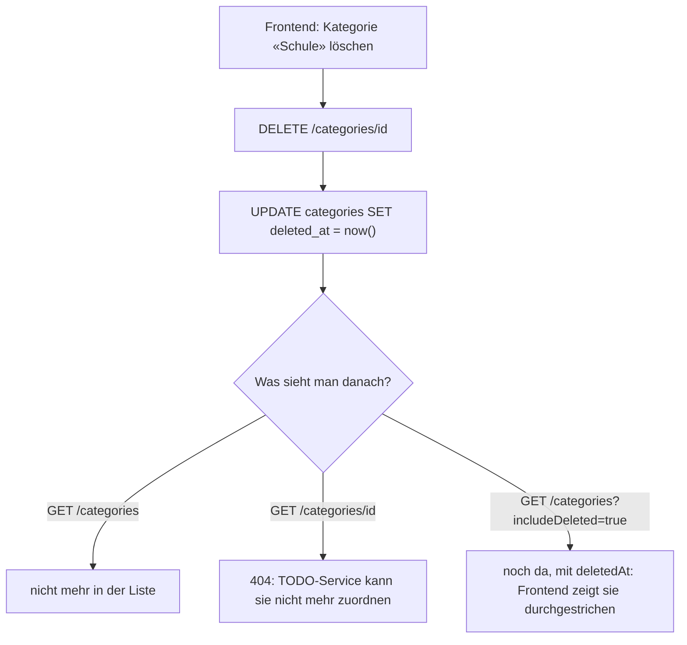

# Erklär-Doku Naima: Kategorien-Service + Ausfalltests

> **TL;DR:** Dein Service verwaltet die Kategorien (Name + Farbe) jedes Benutzers.
> Er ist der **Schiedsrichter** für Dexters TODO-Service: `GET /categories/{id}` sagt «gehört dir und ist aktiv» (200) oder «nein» (404).
> Löschen ist ein **Soft-Delete**: Die Kategorie wird nur als gelöscht markiert, damit bestehende TODOs sie behalten.
> Mit Zachary bist du für die **Ausfalltests** zuständig (`scripts/ha-test.sh`).

**Termine:** Abgabe 26.10.2026 · Demo + Testing 02.11.2026

## 1. Was dein Teil macht

| Endpunkt | Was |
|---|---|
| `GET /categories` (`?includeDeleted=true`) | eigene Kategorien, nach Name sortiert (F05) |
| `POST /categories` `{name, color?}` | erstellen (F05) |
| `GET /categories/{id}` | **Prüf-Endpunkt** für den TODO-Service: 200 nur wenn eigen + aktiv |
| `PATCH /categories/{id}` `{name?, color?}` | umbenennen, Farbe ändern |
| `DELETE /categories/{id}` | Soft-Delete (Regel 5.3.2) |
| `DELETE /categories` | alle eigenen endgültig löschen (nur für Konto löschen) |

## 2. Wie es funktioniert



**Warum Soft-Delete?** Die Planung (Regel 5.3.2) verlangt, dass bestehende TODOs erhalten bleiben.
Würden wir die Kategorie wirklich löschen, zeigten die TODOs auf eine ID, zu der niemand mehr den Namen kennt.
So zeigt das Frontend «~~Schule~~», und neue Zuordnungen sind trotzdem verboten.

## 3. Code-Walkthrough

| Datei | Inhalt |
|---|---|
| `services/category-service/src/app.js` | alle Endpunkte, `findOwnActive()`, Validierung Name/Farbe |
| `src/server.js` | Tabelle `categories` + **partieller eindeutiger Index** |
| `src/auth.js`, `db.js`, `http.js`, `health.js` | gemeinsame Grundstruktur; Kategorien-JWT zusätzlich auf erforderliches exp und UUID-sub geprüft |
| `frontend/js/pages/categories.js` | deine Seite |
| `scripts/ha-test.sh` | Ausfalltests (mit Zachary) |

**Der Kern: nur eigene und aktive Kategorien finden:**

```js
async function findOwnActive(req) {
  const { rows } = await pool.query(
    'SELECT * FROM categories WHERE id = $1 AND user_id = $2 AND deleted_at IS NULL',
    [req.params.id, req.user.id]);   // user_id aus dem JWT, nie aus dem Request (N02)
  if (!rows[0]) throw new HttpError(404, 'CATEGORY_NOT_FOUND', 'Kategorie nicht gefunden');
  return rows[0];
}
```

Diese eine Funktion benutzen `GET`, `PATCH` und `DELETE`. Fremd, gelöscht und nicht existierend sehen alle gleich aus: 404.

**Eindeutige Namen, aber nur unter den aktiven** (`server.js`):

```sql
CREATE UNIQUE INDEX IF NOT EXISTS categories_unique_active_name
  ON categories (user_id, lower(name)) WHERE deleted_at IS NULL;
```

- `user_id`: Zwei Benutzer dürfen beide «Schule» haben.
- `lower(name)`: «Schule» und «schule» gelten als gleich.
- `WHERE deleted_at IS NULL`: Nach dem Löschen ist der Name wieder frei (TC-K03).

Verletzt ein INSERT den Index, meldet PostgreSQL Fehler `23505` → `409 CATEGORY_EXISTS`.

**Soft-Delete:**

```js
await pool.query('UPDATE categories SET deleted_at = now(), updated_at = now() WHERE id = $1 AND user_id = $2', [category.id, req.user.id]);
```

**Farbe prüfen:** nur `#rrggbb` (Regex `^#[0-9a-fA-F]{6}$`), gespeichert in Kleinbuchstaben. Ohne Angabe: Standardblau.


## 4. Betrieb, Tests und Demo

[Naimas Komponentenbeschreibung](naima-umsetzung-tests.md) enthält Integration, JWT-Korrektur, Datenhaltung und Ausfallmessungen. [Sprechzettel](demo-naima.md): komplette Bedienung und typische Fragen. [Testprotokoll](testprotokoll.md): Rohbelege und offene Fälle. Aktiver Einstieg Port 30080, zwei Kategorie-Pods, repliziertes PostgreSQL. Docker-Neustartzeiten nicht als VM-Failover ausgeben.
