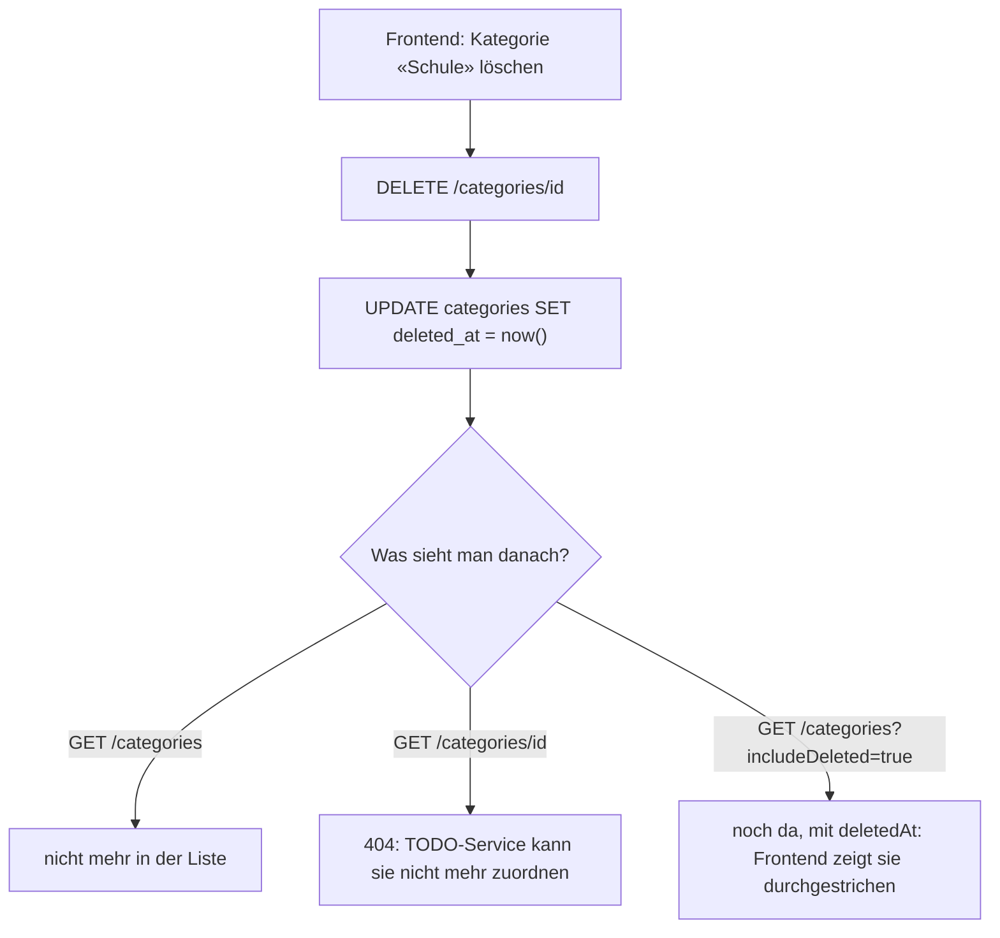

# Erklär-Doku Naima: Kategorien-Service + Ausfalltests

> **TL;DR:** Dein Service verwaltet die Kategorien (Name + Farbe) jedes Benutzers.
> Er ist der **Schiedsrichter** für Dexters TODO-Service: `GET /categories/{id}` sagt «gehört dir und ist aktiv» (200) oder «nein» (404).
> Löschen ist ein **Soft-Delete**: Die Kategorie wird nur als gelöscht markiert, damit bestehende TODOs sie behalten.
> Mit Zachary bist du für die **Ausfalltests** zuständig (`scripts/ha-test.sh`).

**Termine:** Abgabe 26.10.2026 · Demo + Testing 02.11.2026

## 1. Was dein Teil macht

| Endpunkt | Was |
|---|---|
| `GET /categories` (`?includeDeleted=true`) | eigene Kategorien, nach Name sortiert (F05) |
| `POST /categories` `{name, color?}` | erstellen (F05) |
| `GET /categories/{id}` | **Prüf-Endpunkt** für den TODO-Service: 200 nur wenn eigen + aktiv |
| `PATCH /categories/{id}` `{name?, color?}` | umbenennen, Farbe ändern |
| `DELETE /categories/{id}` | Soft-Delete (Regel 5.3.2) |
| `DELETE /categories` | alle eigenen endgültig löschen (nur für Konto löschen) |

## 2. Wie es funktioniert



**Warum Soft-Delete?** Die Planung (Regel 5.3.2) verlangt, dass bestehende TODOs erhalten bleiben.
Würden wir die Kategorie wirklich löschen, zeigten die TODOs auf eine ID, zu der niemand mehr den Namen kennt.
So zeigt das Frontend «~~Schule~~», und neue Zuordnungen sind trotzdem verboten.

## 3. Code-Walkthrough

| Datei | Inhalt |
|---|---|
| `services/category-service/src/app.js` | alle Endpunkte, `findOwnActive()`, Validierung Name/Farbe |
| `src/server.js` | Tabelle `categories` + **partieller eindeutiger Index** |
| `src/auth.js`, `db.js`, `http.js`, `health.js` | gleich wie in den anderen Services |
| `frontend/js/pages/categories.js` | deine Seite |
| `scripts/ha-test.sh` | Ausfalltests (mit Zachary) |

**Der Kern: nur eigene und aktive Kategorien finden:**

```js
async function findOwnActive(req) {
  const { rows } = await pool.query(
    'SELECT * FROM categories WHERE id = $1 AND user_id = $2 AND deleted_at IS NULL',
    [req.params.id, req.user.id]);   // user_id aus dem JWT, nie aus dem Request (N02)
  if (!rows[0]) throw new HttpError(404, 'CATEGORY_NOT_FOUND', 'Kategorie nicht gefunden');
  return rows[0];
}
```

Diese eine Funktion benutzen `GET`, `PATCH` und `DELETE`. Fremd, gelöscht und nicht existierend sehen alle gleich aus: 404.

**Eindeutige Namen, aber nur unter den aktiven** (`server.js`):

```sql
CREATE UNIQUE INDEX IF NOT EXISTS categories_unique_active_name
  ON categories (user_id, lower(name)) WHERE deleted_at IS NULL;
```

- `user_id`: Zwei Benutzer dürfen beide «Schule» haben.
- `lower(name)`: «Schule» und «schule» gelten als gleich.
- `WHERE deleted_at IS NULL`: Nach dem Löschen ist der Name wieder frei (TC-K03).

Verletzt ein INSERT den Index, meldet PostgreSQL Fehler `23505` → `409 CATEGORY_EXISTS`.

**Soft-Delete:**

```js
await pool.query('UPDATE categories SET deleted_at = now(), updated_at = now() WHERE id = $1 AND user_id = $2', [category.id, req.user.id]);
```

**Farbe prüfen:** nur `#rrggbb` (Regex `^#[0-9a-fA-F]{6}$`), gespeichert in Kleinbuchstaben. Ohne Angabe: Standardblau.

## 4. Ausfalltests (mit Zachary)

`./scripts/ha-test.sh` auf der VM ausführen. Es dauert ~1 Minute und gibt eine Markdown-Tabelle aus (→ `docs/testprotokoll.md` §6).

| Test | Was das Skript macht | Was es beweist |
|---|---|---|
| HA-01 | 20 Anfragen, zählt `X-Instance` | Last wird verteilt (10/10) |
| HA-02 | `docker stop todo-service-1` | eine Instanz weg → alles geht weiter |
| HA-03 | `kill -9` auf Node in **category-service-2** | automatischer Neustart, Zeit gemessen (~1.5 s) |
| HA-04 | **beide** category-service stoppen | TODOs gehen weiter, Fehlermeldung verständlich |
| HA-05 | beide todo-service stoppen | Statistik meldet nach 2 s verständlich |
| HA-06 | `docker restart db` | Daten bleiben (N04) |

**Warum nicht einfach `docker kill`?** Docker behandelt `docker kill` wie einen manuellen Stopp und startet den Container **nicht** neu.
Ein echter Absturz ist, wenn der Prozess *im* Container stirbt. Deshalb: `docker exec category-service-2 sh -c 'kill -9 $(pgrep -f "node src/server.js")'`.
Weil `tini` PID 1 ist, endet dann der Container, und `restart: always` greift.

## 5. So demonstrierst du es

1. Kategorien «Schule» (blau) und «Freizeit» (pink) anlegen; nochmals «schule» → Meldung «gibt es schon».
2. Bei den TODOs ein TODO «Schule» zuordnen. Dann «Schule» löschen → TODO zeigt «Schule» **durchgestrichen**, ist aber noch da.
3. **Ausfall live:** `docker stop category-service-1 category-service-2` → TODO-Seite neu laden → gelber Hinweis, TODOs funktionieren.
   TODO mit Kategorie speichern → klare Fehlermeldung. `docker start category-service-1 category-service-2`.
4. Absturz-Test zeigen: Befehl aus Abschnitt 4, dann `docker ps` → «Up 2 seconds».

## 6. Fragen der Lehrperson und Antworten

**Wie weiss der TODO-Service, dass eine Kategorie gültig ist?** Er ruft `GET /categories/{id}` mit dem Token des Benutzers auf. 200 → gültig. 404 → fremd, gelöscht oder unbekannt.
Deshalb braucht es keine zusätzliche Service-zu-Service-Authentifizierung: Mein Service prüft das Benutzer-Token wie bei jedem anderen Aufruf.

**Warum speichert dein Service nicht, welche TODOs zu einer Kategorie gehören?** Das wären doppelte Daten in zwei Services, und die laufen irgendwann auseinander.
Die Zuordnung (`categoryId`) gehört dem TODO, also Dexters Service (Regel 5.3.1).

**Warum Soft-Delete und nicht Hard-Delete?** Damit bestehende TODOs ihre Kategorie behalten und der Name noch angezeigt werden kann (Regel 5.3.2). Beim Konto löschen wird dagegen alles hart gelöscht (Datenschutz).

**Was ist ein partieller Index?** Ein Index, der nur für Zeilen gilt, die eine Bedingung erfüllen (`WHERE deleted_at IS NULL`). So gilt die Eindeutigkeit nur für aktive Kategorien.

**Was passiert, wenn dein Service ganz ausfällt?** TODOs funktionieren weiter. Neue Zuordnungen sind kurz nicht möglich (503 mit Meldung). Die Statistik kommt ohne Kategorienamen.
Das haben wir bewusst so gebaut (Regel 5.3.5) und mit HA-04 getestet.

**Wie lange dauert der automatische Neustart?** Gemessen 1.1–1.5 s mit Docker, ~3 s in Kubernetes. Bei wiederholten Abstürzen wartet Kubernetes immer länger (CrashLoopBackOff), damit ein kaputter Container nicht dauernd neu startet.

**Was ist euer Single Point of Failure?** Die eine PostgreSQL-Instanz (und in Compose das eine Gateway). Dank Volume gehen keine Daten verloren, aber während eines DB-Neustarts sind die Services kurz nicht bereit.

## 7. Deine Tests

- API: `tests/api/category.test.js` TC-K01–K07 → `BASE_URL=http://<vm>:8080 node --test tests/api/category.test.js`
- HA: `scripts/ha-test.sh` (alle), `scripts/k8s-ha-test.sh` (Kubernetes)

## 8. Vor der Abgabe selbst tun

- [ ] Kapitel 4.3 + 5 in `docs/dokumentation.md` lesen und in eigenen Worten anpassen.
- [ ] `./scripts/ha-test.sh` einmal auf deiner VM laufen lassen und die eigene Tabelle ins Testprotokoll übernehmen (mit Datum).
