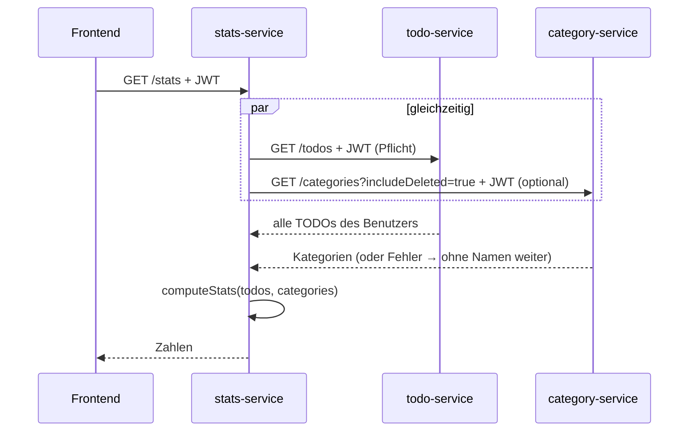

# Erklär-Doku Zachary: Statistik-Service + Ausfalltests

Stand 26.10.2026: ergänzende Lernhilfe; [gemeinsame Doku](dokumentation.md), [Betrieb](betrieb-cluster.md) und [aktuelle Tests](testprotokoll.md) sind massgebend. Individuelle Aussagen selbst prüfen; keine persönliche Durchführung wird ergänzt.

> Prüfstatus: Die unten erwähnten HA-Messungen und Fehlerprotokolle sind auf diesem Branch nicht belegt. Sie gelten als geplante Szenarien, bis eigene VM-Tests dokumentiert sind. Aktuelle Deployment-Anleitung: [deployment-zachary.md](deployment-zachary.md).

> **TL;DR:** Dein Service rechnet: wie viele TODOs offen, in Bearbeitung und erledigt sind (F07) und wie lange das Erledigen im Schnitt dauert (F08).
> Er hat **keine eigene Datenbank**. Bei jeder Anfrage holt er die TODOs bei Dexters Service und die Kategorienamen bei Naimas Service.
> Die Rechnung ist als **reine Funktionen** gebaut und mit Unit-Tests abgesichert. Mit Naima bist du für die **Ausfalltests** zuständig.

**Termine:** Abgabe 26.10.2026 · Demo + Testing 02.11.2026

## 1. Was dein Teil macht

`GET /stats` liefert:

```json
{ "open": 4, "inProgress": 1, "done": 2, "total": 7,
  "averageCompletionSeconds": 5400, "completedLast7Days": 2, "categoriesAvailable": true,
  "byCategory": [ { "name": "Schule", "open": 1, "inProgress": 1, "done": 1, "averageCompletionSeconds": 3600, … } ] }
```

`averageCompletionSeconds: null` heisst «Keine Daten» (keine erledigten TODOs). Das Frontend zeigt dann genau diesen Text.

## 2. Wie es funktioniert



**Warum keine eigene DB?** Die Statistik wäre sonst eine Kopie der TODOs, die veralten kann. So ist sie immer aktuell, und es gibt keine doppelten Daten.
Preis: Ohne TODO-Service gibt es keine Statistik. Dann kommt nach begrenzten Aufrufversuchen eine klare Meldung (HA-05).

## 3. Code-Walkthrough

| Datei | Inhalt |
|---|---|
| `services/stats-service/src/stats.js` | **die Rechnung**: `countByStatus`, `averageCompletionSeconds`, `byCategory`, `computeStats` |
| `src/app.js` | `GET /stats`: Daten parallel holen, Kategorien-Ausfall abfangen |
| `src/client.js` | Aufruf mit 2 s Timeout und zweitem Versuch |
| `test/stats.test.js` | 7 Unit-Tests mit bekannten Zeitwerten |
| `frontend/js/pages/stats.js` | deine Seite, `formatDuration()` (7260 s → «2 Std. 1 Min.») |

**Durchschnitt (F08)** (`stats.js`):

```js
function averageCompletionSeconds(todos) {
  const durations = todos
    .filter((t) => t.status === 'done' && t.completedAt)                     // nur AKTUELL erledigte (Regel 5.3.4)
    .map((t) => (new Date(t.completedAt) - new Date(t.createdAt)) / 1000);    // Millisekunden → Sekunden
  if (!durations.length) return null;                                         // → «Keine Daten»
  return Math.round(durations.reduce((a, b) => a + b, 0) / durations.length);
}
```

Wird ein erledigtes TODO wieder geöffnet, setzt Dexters Service `completedAt` auf `null`. Es zählt dann nicht mehr.

**Parallel holen, Kategorien optional** (`app.js`):

```js
const [response, categories] = await Promise.all([
  callService('Der TODO-Service', `${TODO_URL}/todos`, { token: req.token, requestId: req.id }),   // Fehler → 503
  loadCategories(req),                                                                            // Fehler → null
]);
res.json(computeStats(response.data, categories));
```

`loadCategories` fängt den Fehler ab und gibt `null` zurück. Dann sind `categoriesAvailable: false` und die Namen `null`, aber alle Zahlen stimmen.

**Warum reine Funktionen?** `computeStats` braucht kein Netzwerk und keine DB. Man kann sie mit erfundenen TODOs aufrufen und das Ergebnis exakt prüfen:

```js
test('Durchschnitt aus bekannten Zeitwerten (F08): 1 h und 3 h -> 2 h', () => {
  const todos = [todo('done', '…T10:00', '…T11:00'), todo('done', '…T10:00', '…T13:00')];
  assert.strictEqual(averageCompletionSeconds(todos), 2 * 3600);
});
```

## 4. Ausfallnachweise und Demo

[Cluster-Testprotokoll](testprotokoll.md) und [Präsentation](praesentation.md) sind massgebend. Die 5 Statistik-API-Tests und VM-Isolationen belegen die gemeinsame Integration. Zeige leere Statistik, neues erledigtes TODO und Kategorienauswertung. Unit-Tests nach installiertem npm ci mit npm test ausführen. Historische Docker-/k3s-Messungen nicht als heutige Clusterwerte ausgeben.

## 6. Fragen der Lehrperson und Antworten

**Warum hat der Statistik-Service keine Datenbank?** Er besitzt keine eigenen Daten, er wertet nur die TODOs aus. Eine Kopie müsste man synchron halten (z. B. per Events). So ist es einfacher und immer aktuell.
Bei sehr vielen TODOs wäre eine vorberechnete Statistik (Cache oder Events) schneller.

**Wie wird der Durchschnitt berechnet?** Für jedes aktuell erledigte TODO `completedAt − createdAt`, dann der Mittelwert, in Sekunden gerundet. Keine erledigten → `null` → «Keine Daten».

**Was passiert mit einem TODO, das erledigt und wieder geöffnet wurde?** `completedAt` wird auf `null` gesetzt, es zählt nicht mehr. Wird es nochmals erledigt, zählt die neue Zeit (Regel 5.3.4, Unit-Test «wieder geöffnete zählen nicht»).

**Warum `Promise.all`?** Beide Aufrufe laufen gleichzeitig. Die Antwortzeit ist dann die des langsameren statt der Summe beider.

**Was ist ein Timeout und warum 2 s?** Die maximale Wartezeit auf einen anderen Service. Ohne Timeout könnte eine Anfrage ewig hängen und Ressourcen blockieren. 2 s ist lang genug für normale Antworten (gemessen wenige ms) und kurz genug für den Benutzer.

**Wie testet ihr die Hochverfügbarkeit?** Mit Skripten, die gezielt Container/Pods stoppen oder Prozesse beenden und messen, ob Anfragen weiterlaufen und wie lange ein Neustart dauert. Alles ist reproduzierbar, die Ergebnisse stehen im Testprotokoll.

**Was ist die Korrelations-ID?** nginx gibt jeder Anfrage eine `X-Request-Id`. Jeder Service loggt sie und gibt sie an die nächsten Services weiter.
So findet man in den Logs aller Services alle Zeilen zu *einer* Anfrage: `docker logs stats-service-1 | grep <id>`.

## 7. Deine Tests

- Unit: `services/stats-service/test/stats.test.js` (7 Fälle) → `npm test`
- API: `tests/api/stats.test.js` TC-S01–S05
- HA: `scripts/ha-test.sh`, `scripts/k8s-ha-test.sh`

## 8. Vor der Abgabe selbst tun

- [ ] Kapitel 4.4 + 7 in `docs/dokumentation.md` lesen und in eigenen Worten anpassen.
- [ ] `npm test` selbst laufen lassen. Einen eigenen Unit-Test ergänzen, z. B. «3 erledigte TODOs mit 1, 2 und 6 Minuten → 3 Minuten».
