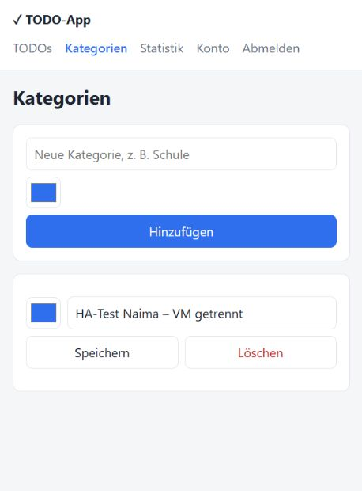

# Naima – Kategorien-Service: Umsetzung und Tests

Stand: 24.10.2026. Dieses Dokument beschreibt nur Naimas Teil der M321-LB2-Arbeit und dessen Integration in die gemeinsame Anwendung.

## Meine Komponente

Der Kategorien-Service liegt unter `services/category-service`. Er verwaltet Kategorien mit Name und Farbe. Jede Kategorie gehört zu einem Benutzer. Andere Benutzer dürfen diese Kategorie weder lesen noch verändern. Beim Löschen bleibt ein Datensatz mit `deletedAt` bestehen: Bestehende TODOs können dadurch weiterhin zugeordnet und in der Statistik erklärt werden.

| Route | Zweck |
|---|---|
| `GET /categories` | Eigene aktive Kategorien auflisten |
| `POST /categories` | Kategorie mit Name und optionaler Farbe erstellen |
| `GET /categories/:id` | Eigene Kategorie lesen |
| `PATCH /categories/:id` | Name oder Farbe bearbeiten |
| `DELETE /categories/:id` | Kategorie als gelöscht markieren |
| `DELETE /categories` | Eigene Kategorien beim Löschen des Benutzerkontos entfernen |

Die genaue Schnittstelle einschliesslich Prüf-Endpunkt ist in `docs/schnittstellen.md` beschrieben. Der Browser verwendet diese Routen mit dem Präfix `/api` über das gemeinsame Gateway.

Ein Kategoriename muss nach dem Entfernen von Leerzeichen 1–40 Zeichen lang sein. Farben werden als `#rrggbb` gespeichert, standardmässig `#2f6fed`. Ein partieller eindeutiger Datenbankindex verhindert doppelte aktive Namen pro Benutzer, unabhängig von Gross-/Kleinschreibung. Nach dem Soft-Delete darf der Name erneut verwendet werden. SQL-Abfragen verwenden Parameter und filtern nach der Benutzer-ID aus dem geprüften JWT.

Die Tabelle `categories` enthält `id`, `user_id`, `name`, `color`, `created_at`, `updated_at` und `deleted_at`. Ein fremder oder gelöschter Eintrag liefert am Einzel-Endpunkt HTTP 404. Ungültige Eingaben liefern 400, doppelte aktive Namen 409 und fehlende oder ungültige Tokens 401.

## Prüfung und Korrekturen

Der Service lief zuerst in einem separaten Compose-Stack auf meiner VM. Zusätzlich war dort ein vollständiger lokaler Demo-Stack gestartet. Das war noch kein Nachweis, dass die VMs der Gruppe zusammenarbeiten.

Bei der Authentifizierung wurde die Prüfung verschärft: Ein gültig signiertes Token muss zusätzlich eine UUID als Benutzer-ID (`sub`) und einen endlichen, gültigen Ablaufzeitpunkt (`exp`) enthalten. Ohne diese Angaben wird der Zugriff abgelehnt. Zehn Regressionstests liegen in `services/category-service/test/auth.test.js`.

Die betroffene `body-parser`-Abhängigkeit wurde über das Lockfile aktualisiert. Für den Kategorien-Service meldete `npm audit` danach keine Schwachstellen. Die Ausfalltests wurden so verbessert, dass gestoppte Testcontainer auch bei einem Fehler wieder gestartet werden.

## Integration und Speicher meines Services

Die gemeinsame Anwendung ist im Schulnetz unter `http://10.4.31.11:30080` erreichbar. Alternative Einstiege sind dieselben URLs mit `.13`, `.16` oder `.17`. Alle führen zum gleichen Datenstand.

Mein Service läuft im Kubernetes-Namespace `todo-app` als Deployment `category-service` mit zwei Pods auf unterschiedlichen VMs. Die Benutzerzuordnung und API bleiben gleich, unabhängig davon, welcher Pod eine Anfrage bearbeitet. `JWT_SECRET` ist für alle Dienste identisch und wird als Kubernetes-Secret bereitgestellt, nicht im Repository gespeichert.

Beide Kategorie-Pods verwenden die Datenbank `categories` über `todo-pg-rw:5432` und die Rolle `category_svc`. Die Datenbank wird durch CloudNativePG über drei PostgreSQL-Instanzen auf drei verschiedenen VMs repliziert. Das sind **keine unabhängigen Kategorie-Datenbanken pro VM**. Ein erfolgreicher Schreibvorgang wartet auf eine weitere dauerhafte Kopie. Die lokale Speicherung erfolgt in PersistentVolumes; Pod-Neustarts löschen diese Daten nicht.

Am Ende der Prüfung liegen die PostgreSQL-Kopien auf `.11`, `.13` und `.16`; `.17` hat ein vorbereitetes Reserve-Volume. Meine VM hält `todo-pg-3`. Auf jeder dieser drei VMs liegt damit eine lokale Kopie desselben Datenbankverbunds. Vor der Migration wurden die Daten gesichert. Die alten Compose-Stacks sind gestoppt und ihr automatischer Neustart ist deaktiviert, damit keine zweite, abweichende Datenhaltung wieder aktiv wird. Die alten Volumes bleiben erhalten.

Zwei getrennte Absicherungen schützen meinen Service: Kubernetes verteilt seine zwei Pods auf unterschiedliche VMs und ersetzt ausgefallene Pods; PostgreSQL repliziert die Daten und kann eine andere Instanz zum schreibenden Primärserver machen. `/health/live` prüft den Prozess. `/health` führt zusätzlich `SELECT 1` in der Datenbank aus. Kubernetes leitet nur an bereite Pods weiter.

Der TODO-Service fragt meinen Service an, um Kategorie-Zuordnungen zu prüfen. Der Statistik-Service verwendet die Kategorie-Namen und Farben. Die Integrationstests prüfen diese Zusammenarbeit, insbesondere auch das Verhalten nach dem Löschen einer Kategorie.

## Meine Tests

| Prüfung | Ergebnis |
|---|---|
| JWT-Regressionstests | 10/10 bestanden |
| Separater Kategorien-Service: Authentifizierung, CRUD, doppelte Namen, fremde Daten | bestanden |
| Kategorien-Prozessabsturz mit automatischem Neustart | bestanden, etwa 0,98 s bis wieder erreichbar |
| Neustart des lokalen Kategorie-Datenbankcontainers, Daten danach noch vorhanden | bestanden, etwa 0,76 s bis wieder erreichbar |
| Gesamte API-Suite über den gemeinsamen Cluster-Einstieg | 35/35 bestanden |
| VM-Ausfall und bestätigte Kategorie-Schreibvorgänge | 4/4 Ausfalltests bestanden; keine bestätigten Testeinträge verloren |
| Browser bei Ausfall meiner VM | Kategorie erstellt und angezeigt; Statistik nach der Umschaltung wieder erreichbar |

Bei den VM-Tests werden nur eigene, zufällig erzeugte Testkonten und Testkategorien verwendet. Die Test-VM wird ungefähr zwei Minuten vom Netz getrennt; ein vorher eingerichteter systemd-Timer hebt die Trennung automatisch auf. Währenddessen wird über eine andere VM geschrieben, gelesen und die Statistik abgefragt. Anschliessend müssen alle bestätigten Kategorie-Einträge über alle vier Einstiege vorhanden sein.

Die folgenden Messungen prüfen die Verfügbarkeit **meines Kategorien-Services und seiner Integration** beim Ausfall jeweils einer Team-VM. Es handelt sich um vollständige Netzwerkisolierung, nicht um einen physischen Stromausfall. Die Isolation beginnt etwa drei Sekunden nach Teststart und endet nach etwa 120 Sekunden. Ein vollständiger Ablauf umfasst Kategorie erstellen, bestehendes TODO lesen und Statistik abrufen.

| Getrennte VM | Ab Testsekunde wieder dauerhaft vollständige Abläufe | Erfolgreiche Abläufe während der Trennung | Bestätigte Kategorie-Einträge nach Rückkehr vorhanden |
|---|---:|---:|---:|
| Naima `.11` | ca. 49 s | 25 | 47/47 |
| Dexter `.13` | ca. 74 s | 16 | 35/35 |
| Leona `.16` | ca. 85 s | 12 | 30/30 |
| Zachary `.17` | ca. 26 s | 34 | 55/55 |

Die längste beobachtete Phase mit fehlgeschlagenen Anfragen dauerte ungefähr 81 Sekunden. Die Werte beruhen auf periodischen Messungen und Anfrage-Timeouts und sind daher Näherungen. Nach jedem Versuch wurde gewartet, bis alle vier Knoten und alle drei PostgreSQL-Kopien wieder gesund waren. Bei den Datenbank-Primärserver-Ausfällen dauerte das Wiedereinbinden der zurückgekehrten Kopie länger als die Wiederherstellung der App.

Die bereits geöffnete Seite unter `.11:30080` konnte während der Trennung meiner VM die Kategorie „HA-Test Naima – VM getrennt“ über einen anderen Einstieg speichern. Die erste Statistik-Abfrage zeigte noch einen verständlichen Fehler; ein erneutes Öffnen der Statistik während der weiter bestehenden Trennung funktionierte. Testkonten werden nach der Prüfung entfernt.



Die ersten VM-Tests deckten Fehler der vorhandenen MicroK8s/dqlite-Version auf. Nach Netzunterbrechungen konnten Änderungsmeldungen oder Schreibzugriffe der Kubernetes-API hängen bleiben. Eingesetzt wird deshalb dqlite v1.8.1 mit der offiziellen Korrektur aus [Upstream-PR 365](https://github.com/canonical/k8s-dqlite/pull/365), gebaut mit Go 1.24.13. Die zugehörigen Upstream-Watch-Tests bestehen. Zusätzlich prüft `scripts/microk8s-watchdog.py` echte Schreibzugriffe samt Änderungsmeldung. Bei einer Störung stimmt es die Wiederherstellung über eine gemeinsame Lease mit einem gesunden Nachbarknoten ab. Die VM-Ausfallmessungen unten gelten für diese korrigierte Konfiguration; die vorher fehlgeschlagenen Versuche werden nicht als bestandene Tests gezählt.

## Selbst prüfen

Auf einer verbundenen VM:

```bash
microk8s kubectl get pods -n todo-app -l app=category-service -o wide
microk8s kubectl get cluster todo-pg -n todo-app
microk8s kubectl get pvc -n todo-app
curl --fail http://10.4.31.11:30080/api/health/category
```

Im Repository:

```bash
cd services/category-service
npm ci
npm test
cd ../..
BASE_URL=http://10.4.31.11:30080 node --test tests/api/category.test.js tests/api/flow.test.js
```

Die wiederholbaren Netzwerk-Ausfalltests liegen in `scripts/cluster-failure-test.cjs` und `scripts/isolate-vm-test.sh`. Nur eine VM gleichzeitig testen; vorher müssen alle Knoten und drei Datenbank-Instanzen gesund sein. Für die SSH-Ausführung wird ein eigener Schlüssel beziehungsweise SSH-Agent benötigt. Zugangsdaten stehen nicht in der Doku oder im Repository.

Ein VM-Ausfall kann während der Erkennung und Datenbank-Umschaltung kurzzeitig Fehler auslösen. Es wird kein unterbrechungsfreier Betrieb garantiert. Eine bereits geöffnete Seite kann ihre API-Adresse wechseln; beim ersten Öffnen oder vollständigen Neuladen einer ausgefallenen VM-Adresse ist ein anderer Einstieg nötig. Die Absicherung ist für einen gleichzeitigen VM-Ausfall ausgelegt. Replikation ersetzt keine Sicherung gegen versehentliches Löschen.
